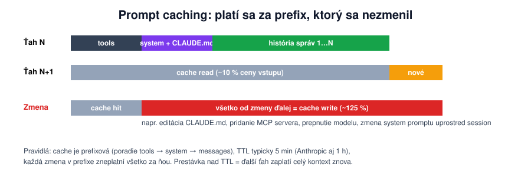
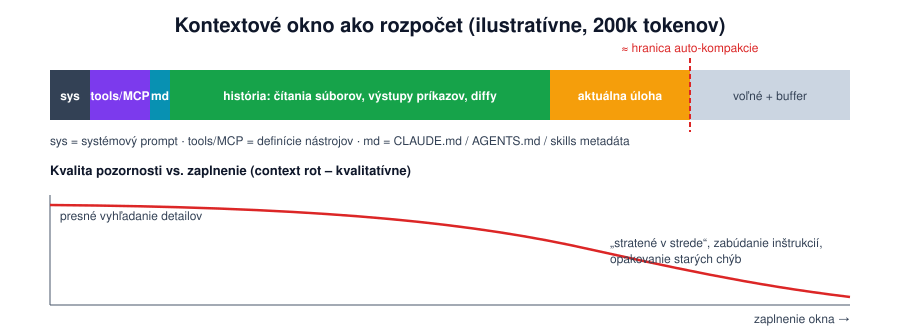
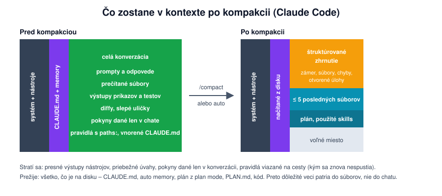

[Obsah](ai-coding-agenti.md)

<a id="2-kontext-ako-agent-pracuje-a-co-ho-stoji"></a>

# 2. Kontext: ako agent pracuje a čo ho stojí

> Kontext je všetko, čo model v danej chvíli vidí. Čo v ňom nie je, o tom agent nevie. Všetko, čo v ňom je, stojí peniaze, čas aj pozornosť modelu.

<a id="21-slucka-a-cena-requestu"></a>

### 2.1 Slučka a cena requestu

Každý coding agent je tá istá slučka: model dostane kontext, vygeneruje volanie nástroja (čítaj, uprav, spusti), agent ho vykoná, výsledok pridá do kontextu a ide znova, kým model nemá čo volať.

Model je bezstavový. Pri **každom** kroku dostane celý kontext odznova: definície nástrojov, systémový prompt, pamäťové súbory a celú doterajšiu konverzáciu vrátane všetkých prečítaných súborov a výstupov príkazov. Kontext teda rastie a každý ďalší krok je drahší než predchádzajúci.

```text
30 krokov × priemerne 60 000 tokenov kontextu = 1,8 milióna vstupných tokenov
výstup za celú úlohu: okolo 15 000 tokenov
```

Cenu tvorí skoro celá vstup. Šetriť sa oplatí na tom, čo ide do kontextu, nie na dĺžke odpovedí. Pri platbe za tokeny (API) to cítiš priamo. Pri platbe za requesty (Copilot) sa ráta počet promptov, ale veľký kontext ťa stojí kvalitu a rýchlosť ([2.3](#23-context-rot-preco-sa-dlha-session-zhorsuje)).

Koľko minula konkrétna úloha, si vieš zmerať sám, pozri [B.4](priloha-b-ceny-a-prikazy.md#b4-spotreba-na-jednu-ulohu).

<a id="22-prompt-caching"></a>

### 2.2 Prompt caching



Model pri spracovaní vstupu počíta pre každý token interný stav, ktorý závisí od všetkých tokenov pred ním. Poskytovateľ si tento stav pre začiatok kontextu (prefix) uloží. Keď ďalší request začína **presne rovnako**, uložený stav použije a účtuje ho zhruba za desatinu ceny ([príloha B](priloha-b-ceny-a-prikazy.md#b1-prompt-caching-ceny)).

Z toho vyplývajú dve pravidlá:
- Cache funguje len po prvú zmenu. Poradie je nástroje, systémový prompt, správy. Zmena na začiatku zneplatní všetko za ňou, zmena na konci nič.
- Cache vyprší po čase nečinnosti. Claude Code pri predplatnom (v rámci limitov plánu) drží cache hlavnej konverzácie 1 hodinu, pri API kľúči, cloudovom poskytovateľovi alebo po prechode na platené kredity 5 minút. Subagenti majú 5 minút. Zmeniť to vieš nastavením `promptCacheTtl` (`5m` alebo `1h`). Po dlhšej pauze sa celý kontext spracuje a zaplatí znova.

**Čím si cache zrušíš (väčšinou nechcene)**, stav Claude Code 10/2026, dokumentácia *Prompt caching*:
- pauza dlhšia než TTL: pri API kľúči stačí káva, pri predplatnom obed,
- prepnutie modelu (každý model má vlastnú cache), aj cez `opusplan` pri vstupe do plan mode a cez skill s vlastným `model`,
- zapnutie alebo vypnutie `/fast`,
- zmena effortu na starších modeloch. Na modeloch 5.5 a Fable 5.1 s API kľúčom alebo predplatným cache zostane,
- pridanie či odobratie MCP servera, ale len keď nebeží tool search. S tool search (predvolene) cache zostane,
- `deny` na celý nástroj, opäť len bez tool search,
- kompakcia (zámerne) a prvá session po aktualizácii Claude Code.

**Cache nerozbije:** úprava súborov v repe, zmena režimu povolení, spustenie skillu, subagent, `/rewind`. Ani úprava `CLAUDE.md` uprostred session, lebo Claude Code ju načíta až po `/clear`, `/compact` alebo reštarte. Kým to neurobíš, agent pracuje so starou verziou.

Ako ti cache funguje, ukáže `/usage` (riadok *Prompt cache (main)* s pomerom zásahov a pravdepodobnou príčinou posledného výpadku).

Po dlhej pauze sa teda pýtaš: oplatí sa zaplatiť celý kontext znova? Ak sú v ňom hlavne výstupy príkazov, nová session s krátkym zhrnutím je lacnejšia aj lepšia. Ak sú v ňom rozhodnutia, ktoré nikde inde nie sú, pokračuj, alebo ich najprv nechaj zapísať do súboru.

<a id="23-context-rot-preco-sa-dlha-session-zhorsuje"></a>

### 2.3 Context rot: prečo sa dlhá session zhoršuje



Pozornosť modelu je obmedzená: každý token „súťaží“ o váhu so všetkými ostatnými. S dlhším kontextom pripadá na každú dôležitú informáciu menej pozornosti, a modely navyše videli pri tréningu oveľa viac krátkych kontextov než dlhých. Kvalita preto klesá dávno pred zaplnením okna. V praxi:
- detaily v strede dlhého kontextu sa prehliadnu („lost in the middle“),
- pokyny zo začiatku (pamäť, zadanie) prehrávajú s čerstvými výstupmi nástrojov,
- agent skúša znova postup, ktorý už zlyhal, lebo neúspešný pokus má stále pred sebou,
- podobný, ale nesúvisiaci kód ho zavedie nesprávnym smerom.

Väčšie okno to nerieši. Problém príde neskôr a každý krok je drahší.

<a id="24-kompakcia-a-checkpointy"></a>

### 2.4 Kompakcia a checkpointy



**Kompakcia** znamená, že agent nechá model zhrnúť doterajšiu konverzáciu a históriu nahradí týmto zhrnutím. Ako to robí Claude Code (stav 10/2026):

1. Spustí sa automaticky pri priblížení k limitu (prah nastavíš cez `/autocompact`) alebo ručne cez `/compact`, voliteľne s pokynom, na čo sa sústrediť.
2. Celá konverzácia ide modelu s pokynom „zhrň ju“. Je to bežný request, s platnou cache lacný.
3. História sa nahradí **štruktúrovaným zhrnutím**: požiadavky a zámer, technické pojmy, čítané a menené súbory s kľúčovými úryvkami, chyby a ich riešenie, otvorené úlohy, čo sa práve robilo.
4. Z disku sa znova načíta projektový `CLAUDE.md`, auto memory, plán z plan mode, čerstvý `git status`, najviac päť naposledy upravených súborov a texty použitých skills.
5. Spustí sa `SessionStart` hook s matcherom `compact`, ak ho máš ([príklad](03-building-blocks.md#hook-3-po-kompakcii-pripomen-stav-ulohy)).

Stratí sa: presné výstupy nástrojov, priebežné úvahy, **pokyny dané len v chate** („odteraz používaj pnpm“), pravidlá viazané na cesty a vnorené `CLAUDE.md` (kým agent znova neotvorí príslušný súbor) a obsah veľkých súborov (zostane len cesta).

```text
Požiadavka: FEAT-150, validácia riadkov podľa SPEC.md bod 8.
Súbory: faktura/models.py (__post_init__ v InvoiceLine), tests/test_models.py (3 testy).
Stav: testy pre množstvo 0 a zápornú cenu prechádzajú.
Otvorené: záporné množstvo, správa chyby musí obsahovať produkt.
Rozhodnutie: validácia v modeli, nie v kalkulačke, lebo musí platiť všade.
```

Zhrnutie je vždy výber, ktorý robí model. Z toho plynie:
- Automatická kompakcia príde uprostred práce a vyberá sama. Ručná medzi krokmi s pokynom („zachovaj rozhodnutia o API a zostávajúce kroky, výstupy testov zahoď“) dopadne lepšie.
- `/clear` nestojí nič, kompakcia áno.
- Čo musí prežiť, patrí do súboru. `PLAN.md` zostane presne taký, aký je, a v novej session stačí „pokračuj podľa PLAN.md, krok 4“.

**Checkpointy.** Agenti si pred zmenou ukladajú stav, takže vieš vrátiť kód aj konverzáciu pred niektorú správu. Pre kontext je podstatné, že **návrat je lepší než oprava**: pri oprave neúspešný pokus zostáva v kontexte a ťahá model späť ([2.3](#23-context-rot-preco-sa-dlha-session-zhorsuje)), pri návrate zmizne. V Claude Code je `/rewind` aj lacnejší než kompakcia, lebo sa vracia k prefixu, ktorý je v cache.

> Keď si agenta opravil dvakrát v tej istej veci, tretiu opravu nepíš. Vráť sa späť a napíš lepší prompt s tým, čo už vieš.

<a id="25-cielene-citanie-a-subagenti"></a>

### 2.5 Cielené čítanie a subagenti

Kontext najviac nezapĺňajú tvoje prompty, ale výstupy nástrojov: súbor s 3 000 riadkami, 500 riadkov logu, výpis inštalácie. Preto:
- daj agentovi adresu („`src/auth/session.ts`, funkcia `refreshToken`“), nie hádanku („niekde v auth“),
- nenúť ho čítať celé moduly, agenti sami grepujú a čítajú výrezy,
- skracuj výstupy (`pytest -q --tb=short`, `| tail -50`), najlepšie natrvalo v skripte alebo hooku,
- logy nevkladaj do promptu, daj cestu k súboru.

**Subagent má vlastné kontextové okno.** Prečíta 40 súborov, zaplní tým svoj kontext, a hlavnému agentovi vráti zhrnutie.

```text
Hlavný kontext:    [zadanie] [výsledok subagenta: 1 500 tokenov] [ďalšia práca...]
Kontext subagenta: [úloha] [40× čítanie, 12× grep: 90 000 tokenov]  ← po skončení sa zahodí
```

Celkovo tokeny neušetrí, často ich minie viac. Šetrí hlavný kontext, takže hlavná session vydrží dlhšie a pracuje lepšie.

**Čo sa oplatí merať** (príkazy v [prílohe B](priloha-b-ceny-a-prikazy.md#b2-prikazy-a-meranie)): čo zaberá kontext pred prvým promptom (nástroje, MCP, pamäť), koľko sessionov skončí automatickou kompakciou (cieľ je takmer žiadna) a spotrebu na mergnutý PR, nie na session. Lacná session, ktorej výsledok zahodíš, je najdrahšia.

<a id="26-vyber-modelu-a-effort"></a>

### 2.6 Výber modelu a effort

Na kvalitu a cenu máš dva gombíky: **model** (kto premýšľa) a **effort** (koľko premýšľa pred odpoveďou a pred každým krokom).

| Alias v Claude Code | Model (Anthropic API, 10/2026) | Na čo |
|---|---|---|
| `opus` | Opus 5.5 | plánovanie, ladenie, zmeny cez viac súborov, nejasné zadanie |
| `sonnet` | Sonnet 5.5 | bežná implementácia podľa jasného plánu, rýchlejší a lacnejší |
| `haiku` | Haiku 5.5 | mechanická práca, prieskum v subagentovi, hromadné úpravy |
| `fable` (alebo `best`) | Fable 5.1, kde je dostupný | najťažšie a najdlhšie úlohy |
| `opusplan` | Opus v plan mode, potom Sonnet | plán od silnejšieho modelu, vykonanie lacnejším |
| `opus[1m]`, `sonnet[1m]` | okno 1M tokenov | len keď naozaj potrebuješ veľa naraz. [2.3](#23-context-rot-preco-sa-dlha-session-zhorsuje) platí aj tu |

Model prepneš cez `/model`, pri štarte `--model`, natrvalo v `settings.json` (`"model"`). Effort má úrovne `low`, `medium`, `high`, `xhigh`, `max` a nastavíš ho cez `/effort`, `--effort`, `effortLevel` v nastaveniach alebo `effort` v hlavičke skillu či subagenta. Na modeloch 5.5 je predvolený `medium`. Slovo `ultrathink` v prompte zvýši effort len pre jednu odpoveď.

| Úloha | Model | Effort |
|---|---|---|
| plán, návrh, nejasné zadanie | `opus` alebo `fable` | `high` |
| implementácia schváleného plánu | `opus` alebo `sonnet` | `medium` |
| ťažká chyba, súbežnosť, výkon | `opus` | `high` až `xhigh` |
| prieskum „kde je X“ v subagentovi | `haiku` | `low` |
| mechanická úprava v 30 súboroch | `sonnet` alebo `haiku` | `low` |

Ako o tom rozmýšľať:
- **Cena úlohy nie je cena tokenu.** Je to cena tokenu × počet krokov × počet pokusov. Slabší model je lacnejší na token, ale ak potrebuje viac krokov, druhý pokus a tvoju opravu, vyjde drahšie aj pomalšie. Tím Claude Code preto používa najsilnejší model skoro na všetko ([príloha C](priloha-c-setup-timu-claude-code.md)).
- **Lacný model tam, kde chyba nič nestojí:** prieskum, ktorého výsledok aj tak čítaš, mechanické úpravy, ktoré overí test.
- **Model meň medzi úlohami, nie uprostred.** Každý model má vlastnú cache ([2.2](#22-prompt-caching)), prepnutie znamená zaplatiť celý kontext znova.
- **Subagent dedí model session.** Vlastný model mu dáš v hlavičke (`model: haiku` ako `explorer` v [3.2](03-building-blocks.md#32-subagenti)) alebo všetkým naraz cez `CLAUDE_CODE_SUBAGENT_MODEL`.
- **`/fast`** prepne na rýchlejší výstup Opusu. Je drahší, hodí sa, keď sedíš pri session a čakanie ťa brzdí.

Organizácia vie povolené modely obmedziť cez `availableModels` v managed settings. V Copilote vyberáš model v okne chatu alebo cez `/model`, cenu tam určuje násobič premium requestov ([B.1](priloha-b-ceny-a-prikazy.md#b1-prompt-caching-ceny)).

> ▸ **Cvičenie 2: Čo stojí kontext (15 min).** `/context` v prázdnej session, po prieskume a so subagentom, potom tá istá otázka s `haiku`/`low` a `opus`/`high`. Postup je v [`cvicenie/README.md`](cvicenie/README.md#cvičenie-2-čo-stojí-kontext).

---

[← 1. Jedna úloha od zadania po diff](01-jedna-uloha.md) · [Obsah](ai-coding-agenti.md) · [3. Building blocks →](03-building-blocks.md)
