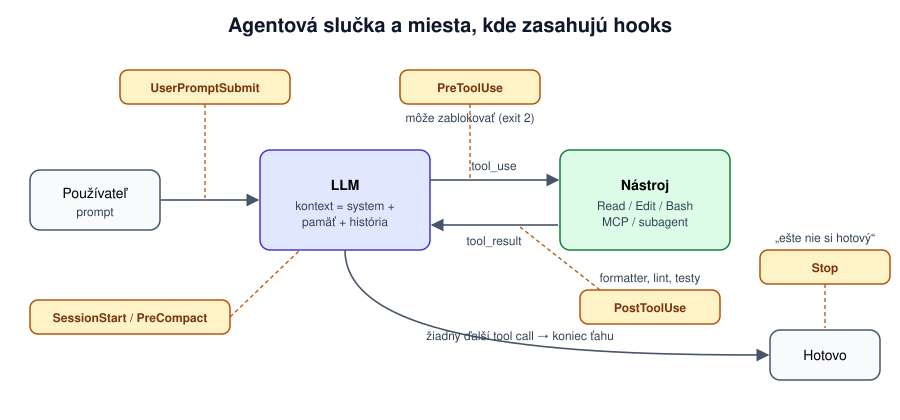

[Obsah](ai-coding-agenti.md)

<a id="3-building-blocks"></a>

# 3. Building blocks



Rozšírenia sa líšia v dvoch veciach: **kto rozhodne o použití** a **kedy zaberajú kontext**. Od toho závisí, na čo sa ktoré hodí.

| Blok | Kto ho spustí | Kedy je v kontexte | Platí vždy? |
|---|---|---|---|
| **Pamäťový súbor** (AGENTS.md, CLAUDE.md…) | nikto, načíta sa sám | vždy | model ho môže prehliadnuť |
| **Slash command** | ty | keď ho zavoláš | — |
| **Skill** | model (alebo ty) | popis vždy, obsah keď treba | nie |
| **Nástroj / MCP** | model | definície vždy, výsledky po zavolaní | nie |
| **Subagent** | model (alebo ty) | len zadanie a výsledok | nie |
| **Hook** | agent pri udalosti, nie model | len ak vráti spätnú väzbu | **áno** |

<a id="31-nastroje-mcp-a-skills"></a>

### 3.1 Nástroje, MCP a skills

**Nástroj** je funkcia s popisom a schémou parametrov. Model ju nevykonáva, len vygeneruje požiadavku na volanie. Popis nástroja je teda prompt (zlý popis, zlé použitie) a definícia zaberá miesto v každom requeste, aj keď sa nástroj nepoužije.

**MCP** je štandardný spôsob, ako agentovi pripojiť nástroje cudzieho systému. Ten istý server funguje v každom hlavnom agentovi.

```jsonc
// .mcp.json (v gite)
{ "mcpServers": {
    "playwright": { "command": "npx", "args": ["@playwright/mcp@latest"] },
    "sentry":     { "type": "http", "url": "https://mcp.sentry.dev/mcp" } } }
```

Server pridáš cez `claude mcp add` (`--scope project` ho zapíše do `.mcp.json` pre celý tím), stav ukáže `/mcp`.

Kedy MCP a kedy nie, vyplýva z ceny. Claude Code má štandardne zapnuté **tool search**: na začiatku session sú v kontexte len mená MCP nástrojov a inštrukcie serverov, plné definície sa načítajú, až keď ich model hľadá. Copilot, Codex a ďalšie nástroje (aj Claude Code s `ENABLE_TOOL_SEARCH=false` alebo za proxy) posielajú celé definície v každom requeste. Každý server je navyše bežiaci proces s tvojimi právami a ďalší zdroj cudzieho obsahu ([4.5](04-bezpecnost.md#45-prompt-injection)). Ak existuje dobré CLI (`gh`, `kubectl`, `psql`), model ho pozná z tréningu a výstup sa dá filtrovať (`| jq`). MCP sa oplatí, keď CLI nie je (prehliadač, SaaS s prihlásením, interné API) alebo chceš ponúknuť len pár bezpečných operácií.

Všetko, čo MCP server vráti, je nedôveryhodný vstup: text issue alebo webu môže obsahovať pokyny pre model (prompt injection). Nebezpečná je kombinácia troch vecí naraz: agent číta cudzí obsah, má prístup k tajomstvám a vie posielať dáta von. Odober aspoň jednu. Podrobnejšie v [4.5](04-bezpecnost.md#45-prompt-injection).

**Skill** je postup v markdowne (`SKILL.md`, prípadne so skriptmi a podkladmi), ktorý sa načítava postupne:

```markdown
---
name: db-migration
description: Use when creating or modifying database migrations (Flyway). Covers naming, rollback and local verification.
---
1. Názov: `V{yyyyMMddHHmm}__{popis}.sql` v `db/migration/`, rollback do `db/rollback/`.
2. Over: `./scripts/migrate-local.sh && ./scripts/verify-schema.sh`
3. Mergnutú migráciu nikdy nemeň, vytvor novú.
Typy a konvencie: [reference/types.md](reference/types.md)
```

V kontexte je stále len `name` a `description`, pár desiatok tokenov. Telo sa načíta, až keď model podľa popisu usúdi, že ho potrebuje, a podklady ešte neskôr. Preto môžeš mať 50 skills bez zaplnenia kontextu, kým 50 odsekov v pamäťovom súbore by ho zaplnilo. Z toho istého dôvodu je popis najdôležitejšia časť skillu: píš ho ako „Use when…“ so slovami, ktoré sa v úlohe objavia.

<a id="32-subagenti"></a>

### 3.2 Subagenti

Subagent je samostatný agent s vlastným kontextom a systémovým promptom, voliteľne s obmedzenými nástrojmi, iným modelom a vlastnou pamäťou. V Claude Code je to markdown súbor v `.claude/agents/`.

#### Subagent 1: read-only prieskumník

```markdown
---
name: explorer
description: Use to find where and how something is implemented when the answer needs reading many files.
tools: Read, Grep, Glob
model: haiku
---
Hľadáš v kóde odpoveď na jednu otázku. Nič nemeníš.
Vráť najviac 30 riadkov: súbor:riadok s jednou vetou ku každému a krátky záver.
```

*„Pomocou explorera zisti, kde všade sa počíta DPH a či sa niekde zaokrúhľuje skôr než na konci.“* Hlavný agent dostane zoznam miest, nie obsah súborov. Lacný model stačí, lebo úloha je hľadanie, nie rozhodovanie.

<a id="subagent-2-spec-reviewer-s-vlastnou-pamatou"></a>

#### Subagent 2: spec reviewer s vlastnou pamäťou

```markdown
---
name: spec-reviewer
description: Use after a change is implemented, before commit. Compares the diff against SPEC.md and the ticket.
tools: Read, Grep, Glob, Bash(git status *), Bash(git diff *), Bash(python -m pytest *)
memory: project
---
Prečítaj SPEC.md, ticket, `git status --short` a `git diff` (nové súbory v diffe nie sú). Posudzuj len výsledok.
Hľadaj porušené pravidlá zo SPEC.md, hranice bez testu, upravené existujúce testy
a zmeny nesúvisiace s ticketom. Každý nález: súbor:riadok, pravidlo, vstup, pri ktorom zlyhá.
Pred začatím si pozri svoju pamäť, na konci do nej zapíš chyby, ktoré sa opakujú.
```

Reviewer je užitočný práve preto, že nevidel tvoju konverzáciu. Neovplyvnia ho zdôvodnenia, ktorými sa hlavný agent presvedčil, že je všetko v poriadku. Vďaka `memory: project` si nesie poznámky medzi review ([3.5](#35-dlhodoba-pamat-ako-vznika)).

#### Kedy dávajú zmysel

Subagent pomáha, keď platí aspoň jedno:
- **veľa čítania, krátky výsledok** (80 000 tokenov prieskumu, 2 000 tokenov záveru),
- **nezávislý pohľad**: reviewer bez kontextu autora nájde viac,
- **nezávislé časti naraz**: paralelný prieskum troch služieb. Paralelné úpravy len v oddelených git worktrees,
- **obmedzené práva alebo lacnejší model** na mechanickú prácu.

Neprináša nič, keď kroky na sebe závisia (subagent nevie nič, čo mu nenapíšeš), keď je úloha malá, keď s ním potrebuješ priebežne debatovať, alebo keď je to len „rola“ („senior architekt“) s tým istým modelom a tými istými informáciami.

> Test: vieš napísať zadanie bez odkazu na „to, čo sme riešili vyššie“ a výsledok opísať na pár riadkoch? Ak áno, subagent dáva zmysel.

<a id="33-hooks-pravidla-ktore-platia-vzdy"></a>

### 3.3 Hooks: pravidlá, ktoré platia vždy

Model sa rozhoduje pravdepodobnostne. Pokyn „vždy spusti formátovač“ dodrží väčšinou, a s dlhším kontextom menej ([2.3](02-kontext.md#23-context-rot-preco-sa-dlha-session-zhorsuje)). Hook je príkaz, ktorý pri udalosti spúšťa samotný nástroj, nie model, preto sa vykoná vždy.

| Udalosť (Claude Code) | Na čo sa hodí |
|---|---|
| `PreToolUse` | zablokovať príkaz alebo úpravu chránených súborov, dôvod dostane model |
| `PostToolUse` | formátovač, linter, skrátenie výstupu |
| `UserPromptSubmit` | doplniť kontext, zachytiť tajomstvo v prompte |
| `Stop` | spustiť testy, pri chybe poslať agenta späť |
| `SessionStart` | doplniť aktuálny stav na začiatku alebo po kompakcii |

Hook dostane na stdin JSON s detailmi udalosti a odpovie exit kódom alebo JSON-om. Exit kód 2 pri `PreToolUse` akciu zablokuje a stderr dostane model ako vysvetlenie. Konfigurácia je v `.claude/settings.json` a skripty v `.claude/hooks/`, obe v gite. Hotové hooky aj subagentov na skopírovanie nájdeš v [`claude tutorial/`](claude%20tutorial/README.md).

<a id="hook-1-zakaz-menit-commitnute-testy"></a>

#### Hook 1: zákaz meniť commitnuté testy

```bash
#!/usr/bin/env bash
# .claude/hooks/protect-tests.sh  (PreToolUse, matcher Edit|Write)
path=$(jq -r '.tool_input.file_path // empty')
case "$path" in
  */tests/*|*/test/*|*_test.py|*/test_*.py)
    if git -C "$CLAUDE_PROJECT_DIR" ls-files --error-unmatch "$path" >/dev/null 2>&1; then
      echo "Súbor $path je commitnutý test a nesmieš ho meniť. Napíš nový test do nového súboru, alebo sa opýtaj." >&2
      exit 2
    fi
    ;;
esac
exit 0
```

```jsonc
{ "hooks": {
    "PreToolUse":  [{ "matcher": "Edit|Write", "hooks": [{ "type": "command", "command": ".claude/hooks/protect-tests.sh", "onFailure": "block" }] }],
    "PostToolUse": [{ "matcher": "Edit|Write", "hooks": [{ "type": "command",
                      "command": "jq -r '.tool_input.file_path' | grep '\\.py$' | xargs -r ruff format" }] }] } }
```

Blokuje sa len to, čo je v gite, takže testy, ktoré agent v session sám vytvoril, upravovať môže. Pravidlo je zámerne na úrovni súboru: nové testy idú do nového súboru a pomocné funkcie si z pôvodného importujú (príklad v [kapitole 1](01-jedna-uloha.md)). Nové súbory potom pri kontrole uvidíš cez `git status`, nie cez `git diff`. Druhý hook dorieši formátovanie, aby kvôli nemu nepadalo CI.

<a id="hook-2-nepustit-agenta-kym-neprechadzaju-testy"></a>

#### Hook 2: nepustiť agenta, kým neprechádzajú testy

```bash
#!/usr/bin/env bash
# .claude/hooks/tests-must-pass.sh  (Stop, timeout 120)
input=$(cat)
# Ak už agent pokračuje kvôli tomuto hooku, druhýkrát ho nezastavuj.
[ "$(jq -r '.stop_hook_active' <<<"$input")" = "true" ] && exit 0

cd "$CLAUDE_PROJECT_DIR" || exit 0
# Zmenili sa len testy alebo dokumentácia? Potom testy smú padať (TDD, otázka, prieskum).
changed_code=$(git status --porcelain --untracked-files=all -- . | cut -c4- |
  grep -Ev '(^|/)tests?/|(^|/)test_[^/]*\.py$|_test\.py$|(^|/)\.claude/|\.md$')
[ -z "$changed_code" ] && exit 0

if ! output=$(python -m pytest -q 2>&1); then
  reason=$(printf 'Zmenil si kód a testy neprechádzajú, oprav ich pred dokončením:\n%s' "$(tail -n 20 <<<"$output")")
  jq -n --arg reason "$reason" '{decision: "block", reason: $reason}'
fi
exit 0
```

`decision: "block"` znamená, že agent neskončí a `reason` dostane ako ďalší vstup. Posielajú sa len posledné riadky, lebo všetko ide do kontextu. Kontrola `stop_hook_active` bráni nekonečnej slučke. Claude Code navyše po ôsmich blokovaniach za sebou hook ignoruje (limit zmeníš cez `CLAUDE_CODE_STOP_HOOK_BLOCK_CAP`). Počítadlo sa vynuluje, keď agent zavolá nástroj.

Hook sa zapne, až keď sa v pracovnom adresári zmenil kód mimo testov. Bez tejto podmienky by išiel proti postupu z [5.2](05-postup-prace.md#52-tdd-a-overenie-pred-dokoncenim): pri „napíš testy, over, že padajú, a zastav“ by agentovi vrátil pokyn „oprav ich“ a ten by začal implementovať, hoci mal čakať na tvoje schválenie. Rovnako by blokoval session, v ktorej sa agenta len na niečo pýtaš a testy padajú už od začiatku.

<a id="hook-3-po-kompakcii-pripomen-stav-ulohy"></a>

#### Hook 3: po kompakcii pripomeň stav úlohy

```jsonc
"SessionStart": [{ "matcher": "compact", "hooks": [{ "type": "command",
  "command": "cd \"$CLAUDE_PROJECT_DIR\" && git branch --show-current && git log --oneline -5 && cat PLAN.md 2>/dev/null" }] }]
```

Výstup dostane model hneď po kompakcii. Vracia presne to, čo mohlo zo zhrnutia vypadnúť ([2.4](02-kontext.md#24-kompakcia-a-checkpointy)), a nespolieha sa pri tom na výber modelu.

Štvrtý príklad, maskovanie čísel kariet vo výstupoch nástrojov, je v kapitole o bezpečnosti ([4.6](04-bezpecnost.md#hook-4-cisla-kariet-sa-nedostanu-k-modelu)).

Keď na rozhodnutie nestačí skript, hook môže byť typu `agent`: malý agent si prečíta súbory a vráti „ok“ alebo dôvod. V Claude Code je to zatiaľ experimentálne, pomalšie a drahšie. Ak sa dá rozhodnúť skriptom, použi skript.

#### Na čo myslieť

- Hooky bežia pri každom kroku, musia byť rýchle a dať sa spustiť opakovane.
- Čo hook vráti modelu, je prompt. Napíš, čo má spraviť inak, nielen čo je zle.
- Hook chráni len to, čo pozná. Agent môže ten istý súbor zmeniť cez `sed` v shelli. Poslednou poistkou je kontrola diffu a CI.
- Ak hook spadne alebo vyprší, akcia sa štandardne vykoná. Pri ochranných hookoch nastav `"onFailure": "block"` (od Claude Code 2.1.295), ako v Hooku 1 vyššie.
- Hooky bežia s tvojimi právami. Kontroluj ich ako bežný kód.

<a id="34-pamatove-subory-agentsmd-claudemd-a-copilot-instructionsmd"></a>

### 3.4 Pamäťové súbory: AGENTS.md, CLAUDE.md a copilot-instructions.md

Agent si medzi sessionami nič nepamätá. „Pamäť“ sú súbory, ktoré nástroj vloží na začiatok kontextu.

| Súbor | Kto ho číta |
|---|---|
| **`AGENTS.md`** | Codex, Copilot, Cursor, Aider, Gemini CLI a ďalší (otvorený štandard, platí aj v podpriečinkoch) |
| **`CLAUDE.md`** | Claude Code (osobný v `~/.claude/`, projektový, v podpriečinkoch, importy `@cesta`) |
| **`.github/copilot-instructions.md`** | Copilot (cielené pravidlá v `.github/instructions/*.instructions.md` cez `applyTo`) |

Pri viacerých nástrojoch drž obsah na jednom mieste: `CLAUDE.md` obsahuje `@AGENTS.md` a pod tým len veci špecifické pre Claude Code.

Čo do pamäťového súboru patrí, vyplýva z toho, že ho platíš v každom requeste a s dĺžkou ho model dodržiava horšie:
- **patrí tam** to, čo agent sám nezistí: príkazy na testy a build, neštandardné konvencie a zákazy s dôvodom, pasce („`integration/` potrebuje Docker“, „`generated/` sa needituje“), hrubá mapa repa,
- **nepatrí tam** to, čo zistí z kódu za pár sekúnd, všeobecné rady („píš čistý kód“), dlhé návody na zriedkavé úlohy (skill) a pravidlá bez výnimky (hook).

Rozumná hranica je okolo 200 riadkov.

Kostru `CLAUDE.md` vygeneruje `/init`: prečíta repo a navrhne obsah. Ber ju ako návrh a skráť ju, lebo veľkú časť by agent zistil z kódu aj sám. Podrobný návod s príkladom dobrého a zlého súboru je v [`claude tutorial/claude-md-navod.md`](claude%20tutorial/claude-md-navod.md).

<a id="35-dlhodoba-pamat-ako-vznika"></a>

### 3.5 Dlhodobá pamäť: ako vzniká

Pamäť, ktorá prežije koniec session, vzniká len tak, že niekto niečo zapíše do súboru, ktorý sa pri ďalšej session načíta. Líši sa len, kto zapisuje a kam.

**1. Ty alebo tím, do súborov v gite.** Najspoľahlivejšie, lebo to prejde review a dostane sa ku všetkým. Po oprave chyby: *„Zapíš do CLAUDE.md, ako sa tomu nabudúce vyhnúť.“* Tím Claude Code to robí aj v review: v PR označí `@claude` a ten doplní pravidlo do `CLAUDE.md` v tom istom PR.

**2. Agent sám, do auto memory.** Claude Code si počas práce zapisuje poznámky, keď usúdi, že sa zídu aj nabudúce (stav 10/2026):
- Ukladajú sa do `~/.claude/projects/<projekt>/memory/`, na tvojom počítači, nie v gite. Zdieľajú ich všetky worktrees toho istého repa.
- Každá poznámka je samostatný súbor s typom: `user` (kto si a ako pracuješ), `feedback` (tvoje opravy a schválené postupy), `project` (rozbehnutá práca a rozhodnutia, ktoré nie sú v kóde ani v gite), `reference` (kde hľadať mimo projektu).
- `MEMORY.md` je index s jedným riadkom na poznámku. Na začiatku session sa načíta jeho prvých 200 riadkov, samotné poznámky až keď treba. Je to ten istý princíp postupného načítania ako pri skills.
- Neukladá sa, čo sa dá zistiť z kódu alebo gitu, ani čo už je v `CLAUDE.md`.

```markdown
---
name: testy-hranicne-hodnoty
description: Pri zmenách výpočtov faktúry chce používateľ testy presne na hraniciach zo SPEC.md
type: feedback
---
Pri zmene vo faktura/calculator.py pridaj test presne na hranici pravidla (10 ks, posledný deň kupónu, 100,00 €).
**Prečo:** BUG-142 vznikol, lebo testy používali 20 ks a hranica 10 ks nebola pokrytá.
```

„Zapamätaj si…“ ide do auto memory, „pridaj do CLAUDE.md“ do gitu. Poznámky si občas prejdi (`/memory`): agent si môže zapamätať aj niečo nesprávne alebo zastarané.

**3. Subagent, do vlastnej pamäte.** S `memory: project` si subagent vedie poznámky v `.claude/agent-memory/<meno>/`, čo môže byť v gite. Hlavný agent ich nevidí a naopak.

**4. Stav úlohy v súbore.** `PLAN.md` nie je pamäť v pravom zmysle, ale prežije `/clear`, kompakciu aj novú session.

| Informácia | Kam |
|---|---|
| pravidlo pre celý tím | `AGENTS.md` / `CLAUDE.md` v gite |
| osobná preferencia | `~/.claude/CLAUDE.md` alebo auto memory |
| čo si agent všimol pri práci | auto memory |
| skúsenosti špecializovaného subagenta | pamäť subagenta |
| stav rozpracovanej úlohy | `PLAN.md` |
| pravidlo, ktoré sa nesmie porušiť | hook |

Ak tvoj nástroj automatickú pamäť nemá, rovnaký efekt dosiahneš zápisom do `AGENTS.md` po každej oprave.

<a id="36-vlastny-skill-krok-za-krokom"></a>

### 3.6 Vlastný skill krok za krokom

Skills a slash commands sú v Claude Code jeden mechanizmus: `.claude/commands/ticket.md` aj `.claude/skills/ticket/SKILL.md` vytvoria príkaz `/ticket`. Skill má navyše priečinok na podklady a hlavičku, ktorá určuje, kto a kedy ho spustí. Oplatí sa, keď ten istý prompt píšeš tretíkrát, alebo keď postup potrebuje vlastné skripty či podklady.

**1. Kam.** `.claude/skills/<meno>/SKILL.md` v projekte (v gite, pre tím) alebo `~/.claude/skills/<meno>/SKILL.md` (len pre teba, vo všetkých projektoch).

**2. Hlavička.** Všetky polia sú voliteľné, dôležité sú tieto:

| Pole | Na čo |
|---|---|
| `description` | podľa nej model rozhodne, či skill načíta sám. Najprv hlavný prípad použitia, „Use when…“ |
| `argument-hint` | nápoveda pri písaní, napr. `<ticket-id>` |
| `disable-model-invocation: true` | spustíš ho len ty cez `/meno`. Pre všetko, čo má vedľajšie účinky (commit, deploy, push) |
| `allowed-tools` | nástroje povolené bez pýtania, kým skill beží, napr. `Read Grep Bash(python -m pytest *)` |
| `model`, `effort` | iný model alebo effort len pre tento skill |
| `context: fork` | skill beží v samostatnom subagentovi, hlavný kontext dostane len výsledok |
| `paths` | skill sa ponúka len pri práci so súbormi podľa vzoru |

**3. Telo.** Bežný markdown s pokynmi. Dve vychytávky:
- `$ARGUMENTS` nahradí všetko, čo napíšeš za príkaz. `$0`, `$1`… jednotlivé argumenty.
- `` !`príkaz` `` sa spustí **pred** odoslaním modelu a jeho výstup sa vloží do textu. Agent tak hneď vidí `git status` alebo obsah súboru a nemusí ho zisťovať ďalším krokom.

Vzor je skill [`/ticket`](claude%20tutorial/.claude/skills/ticket/SKILL.md), ktorý zabalí postup z kapitoly 1:

```markdown
---
name: ticket
description: Work on a ticket from tickets/ (BUG-xxx, FEAT-xxx) with the plan-first, test-first workflow. Use when the user asks to implement or fix a ticket.
argument-hint: <ticket-id>
disable-model-invocation: true
allowed-tools: Read Grep Glob Bash(python -m pytest *) Bash(git diff *) Bash(git status *) Bash(git log *)
---
Pracuješ na tickete **$ARGUMENTS** (súbor `tickets/$ARGUMENTS.md`).

## Stav repa
!`git status --short`

## Postup
1. Prečítaj ticket a príslušné body SPEC.md. 2. Navrhni plán a počkaj na schválenie.
3. Najprv testy, ktoré padajú, v novom súbore. 4. Najmenšia oprava. 5. Dôkaz: pytest, git status --short a git diff --stat.
```

**4. Test.** `/ticket FEAT-150` overí ručné spustenie. Pri skille bez `disable-model-invocation` over aj automatické načítanie otázkou bez lomky, ktorá zodpovedá popisu. Ak sa nenačíta, uprav `description`, nie telo. Zmeny v súbore platia hneď, bez reštartu. `/skill-doctor` ukáže, ako často sa ktorý skill používa a koľko kontextu stojí.

**Kto ho má spúšťať:** postup s vedľajšími účinkami spúšťaj sám (`disable-model-invocation: true`). Znalosti, ktoré sa hodia „keď treba“ (konvencie migrácií, ako pridať endpoint), nechaj modelu.

<a id="37-zdielanie-v-time-pluginy"></a>

### 3.7 Zdieľanie v tíme: pluginy

Pre jeden repozitár stačí `.claude/` v gite: skills, agenti, hooky a `settings.json` prídu každému s `git pull`. Keď chceš to isté vo viacerých repách alebo s verziami, zabaľ to do **pluginu**.

- **Plugin** je priečinok so skills, agentmi, hookmi a MCP servermi a s manifestom `.claude-plugin/plugin.json`. Jeho skill sa volá s menom pluginu: `/moj-plugin:review`.
- **Marketplace** je repozitár so zoznamom pluginov (`.claude-plugin/marketplace.json`). Pridáš ho cez `/plugin marketplace add <repo>`, plugin nainštaluješ cez `/plugin`. Oficiálny marketplace Anthropicu sa pridá sám.
- **Rozsah inštalácie:** pre teba vo všetkých projektoch (user), pre tím v repe (project, zapíše sa do `.claude/settings.json`, kolegovia ho len doinštalujú), alebo len pre teba v repe (local).
- **Vývoj:** `claude --plugin-dir ./moj-plugin` načíta plugin z priečinka bez marketplace.

Zapnutý plugin je súčasťou **každej** session: popisy jeho skills a agentov sú v kontexte, hooky sa spúšťajú a MCP servery bežia, všetko s tvojimi právami. Inštaluj len to, čo používaš, a pred inštaláciou plugin skontroluj ako cudzí kód. Nepoužívaný vypneš cez `/plugin` alebo `claude plugin disable`. Organizácia vie cez managed settings povoliť len vybrané marketplaces.

V Copilote zodpovedajú pluginom zdieľané `.github/agents/`, `.github/skills/` a organizačné inštrukcie. Formát `SKILL.md` je rovnaký.

<a id="38-presety-spustenia"></a>

### 3.8 Presety: čistá session a session s MCP

Všetko z tejto kapitoly sa štandardne zapína v **každej** session: MCP servery z user scope, z `.mcp.json` v repe aj z pluginov, popisy všetkých skills a agentov, hooky pluginov. Väčšinu úloh to nepotrebuje a platíš za to trikrát:

- **kontext:** popisy a inštrukcie serverov idú v každom requeste, `/context` ukáže koľko,
- **bezpečnosť:** každý MCP server je proces s tvojimi právami a zdroj cudzieho obsahu ([4.5](04-bezpecnost.md#45-prompt-injection)),
- **ladenie:** keď sa agent správa divne, nevieš, či za to môže model, skill, hook alebo MCP.

Preto si sprav **presety**: štandardne štartuj bez MCP a MCP zapínaj vedome, len na úlohu, ktorá ho potrebuje. Skills a subagentov nechaj zapnutých, lebo na nich stojí postup zo školenia (`/ticket`, `explorer`, `spec-reviewer`) a v kontexte z nich sú len krátke popisy. Postačia flagy `claude` (overené na 2.1.309, `claude --help`):

| Flag | Čo robí |
|---|---|
| `--safe-mode` | vypne všetky prispôsobenia: `CLAUDE.md`, skills, pluginy, hooky, MCP, vlastné commands a agentov. Prihlásenie, model a povolenia fungujú |
| `--strict-mcp-config` | ignoruje všetky MCP konfigurácie okrem tých z `--mcp-config`; bez neho = žiadne MCP |
| `--mcp-config a.json b.json` | načíta len tieto MCP servery |
| `--disable-slash-commands` | vypne všetky skills a commands |
| `--disallowedTools Agent` | vypne subagentov, aj vstavaných (Explore, Plan) |
| `--setting-sources user` | ignoruje `.claude/settings*.json` z repa (hooky, povolenia a pluginy projektu), vhodné na cudzie repo |
| `--bare` | ako `--safe-mode` pre skripty, ale funguje len s `ANTHROPIC_API_KEY`, nie s predplatným |

MCP servery si drž ako samostatné súbory, jeden server na súbor, napr. `~/.claude/presets/mcp/playwright.json`:

```json
{ "mcpServers": { "playwright": { "command": "npx", "args": ["@playwright/mcp@latest"] } } }
```

a `~/.claude/presets/mcp/context7.json`:

```json
{ "mcpServers": { "context7": { "type": "http", "url": "https://mcp.context7.com/mcp" } } }
```

Presety do `~/.bashrc`:

```bash
# --- Claude Code presety ---
CC_MCP=~/.claude/presets/mcp

# holý agent: bez CLAUDE.md, skills, pluginov, hookov, MCP a vlastných agentov (ladenie, porovnanie)
alias cc0='claude --safe-mode'

# bežná práca: CLAUDE.md, hooky, povolenia, skills a subagenti áno; MCP nie
alias cc='claude --strict-mcp-config'

# úplne holá práca bez skills a subagentov (napr. na porovnanie, čo pridávajú)
alias ccmin='claude --strict-mcp-config --disable-slash-commands --disallowedTools Agent'

# cudzie repo: ako cc, navyše ignoruje .claude/settings*.json z repa
alias ccx='cc --setting-sources user'

# ako cc, ale s vybranými MCP:  ccm playwright context7 [ďalšie flagy]
ccm() {
  local cfgs=()
  while [ -f "$CC_MCP/$1.json" ]; do cfgs+=("$CC_MCP/$1.json"); shift; done
  [ ${#cfgs[@]} -gt 0 ] || { echo "použitie: ccm <server>... ($(ls "$CC_MCP" | sed 's/\.json$//' | xargs))"; return 1; }
  claude --strict-mcp-config --mcp-config "${cfgs[@]}" "$@"
}

# všetko, čo je nainštalované (pôvodné správanie): claude
```

Aliasy sa skladajú s ďalšími flagmi (`cc --model sonnet`, `ccm playwright -c`). Po štarte over cez `/mcp` a `/context`, čo naozaj beží: MCP konektory z claude.ai účtu a pluginy sa pridávajú z viacerých miest.

**Pluginy** sa nedajú vypnúť flagom pre jednu session (okrem `--safe-mode`). Riešenie je rozsah inštalácie z [3.7](#37-zdielanie-v-time-pluginy): do user scope daj len to, čo chceš všade (LSP pluginy nižšie), ostatné inštaluj s `--scope local` alebo `project` len do repa, kde to treba. Na jednorazové skúšanie stačí `--plugin-dir`. Koľko plugin stojí kontextu, ukáže `claude plugin details <meno>`.

#### Pluginy pre C++ a Python vývojára

Z oficiálneho marketplace (`claude-plugins-official`, `/plugin`). Pravidlo z 3.7 platí: menej je viac.

| Plugin | Prečo | Kde |
|---|---|---|
| **`clangd-lsp`**, **`pyright-lsp`** | Agent dostane jazykový server: definície, referencie a **diagnostiku hneď po úprave**. Bez neho hľadá grepom, čo v C++ (šablóny, preťaženia, makrá) často minie, a chybu typu zistí až z buildu. Najväčší prínos za najmenší kontext. Treba mať nainštalovaný `clangd` s `compile_commands.json` (`cmake -DCMAKE_EXPORT_COMPILE_COMMANDS=ON`) a `pyright` | user scope |
| `commit-commands` | `/commit`, `/commit-push-pr`: opakovaný postup ako command (bod 5 v [prílohe C](priloha-c-setup-timu-claude-code.md)) | user scope |
| `pr-review-toolkit` | špecializovaní revieweri: testy, spracovanie chýb, tiché zlyhania, návrh typov. Dopĺňa vstavaný `/code-review` | podľa potreby |
| `security-guidance` | hook upozorní na rizikové vzory pri úprave (`eval`, `pickle`, `subprocess(shell=True)`, …) | projekty so vstupom zvonka |
| `code-simplifier` | subagent na upratanie kódu po funkčnej zmene | podľa potreby |
| `hookify` | z konverzácie spraví hook („toto už nerob“), [3.3](#33-hooks-pravidla-ktore-platia-vzdy) bez písania bashu | podľa potreby |
| `context7` (MCP) | aktuálna dokumentácia knižníc (pybind11, FastAPI, Qt, Boost…) v správnej verzii, menej vymyslených API | **cez preset** `ccm context7` |
| `qt-development-skills` | review a konvencie Qt C++/QML | len Qt projekty |

Opatrne: `serena` (MCP na sémantickú navigáciu) sa prekrýva s LSP pluginmi, nemaj oboje. `github`, `gitlab`, `sentry` či `atlassian` dávaj do presetov, nie natrvalo; na GitHub zvyčajne stačí `gh` ([3.1](#31-nastroje-mcp-a-skills)). `ralph-loop` (agent v slučke bez konca) páli tokeny, len s rozpočtom a v sandboxe.

> ▸ **Cvičenie 3: Skill, hook a reviewer (25 min).** Vlastný skill `/spec-check`, hook, ktorý zastaví úpravu testu, a `spec-reviewer` na zámerne neúplnú zmenu. Postup je v [`cvicenie/README.md`](cvicenie/README.md#cvičenie-3-skill-hook-a-reviewer).

---

[← 2. Kontext](02-kontext.md) · [Obsah](ai-coding-agenti.md) · [4. Bezpečnosť →](04-bezpecnost.md)
