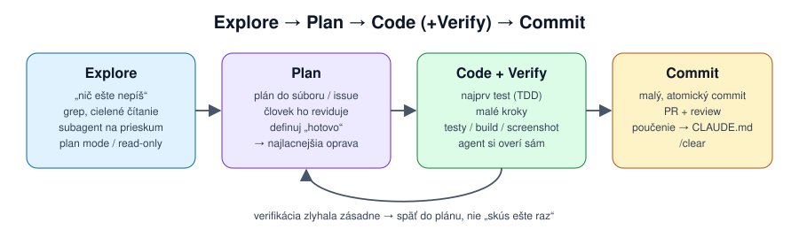

[Obsah](ai-coding-agenti.md)

<a id="5-postup-prace"></a>

# 5. Postup práce

<a id="51-explore--plan--code--commit"></a>

### 5.1 Explore → Plan → Code → Commit



Postup z [kapitoly 1](01-jedna-uloha.md) odporúčajú Anthropic, OpenAI aj GitHub. Každá fáza má mechanický dôvod:

1. **Prieskum** (bez písania kódu) dostane do kontextu správne veci skôr, než sa agent rozhodne. Veľký prieskum cez subagenta.
2. **Plán** je najlacnejšie miesto na opravu: jedna veta namiesto prepisovania kódu a neúspešného pokusu v kontexte. Režim plánovania agentovi zakáže upravovať súbory, takže nezačne predčasne.
3. **Kód po krokoch**, každý overený testom, buildom alebo screenshotom. Agent bez spätnej väzby nevie, že sa mýli.
4. **Malý commit**, poučenie do pamäte, nová session.

Plán vynechaj, keď zmenu opíšeš jednou vetou a diff bude mať pár riadkov.

<a id="52-tdd-a-overenie-pred-dokoncenim"></a>

### 5.2 TDD a overenie pred dokončením

Agent pracuje najlepšie s cieľom, ktorý si vie sám overiť. Test je presne taký cieľ:

1. „Napíš testy pre X podľa špecifikácie. Neimplementuj.“
2. „Spusti ich a over, že padajú zo správneho dôvodu.“
3. Testy commitni. Agentovi to nezabráni ich neskôr zmeniť, ale `git diff <commit> -- tests/` ukáže každú zmenu.
4. „Implementuj, kým testy neprejdú. Testy nemeň.“ Ak to musí platiť vždy, vynúť to [hookom](03-building-blocks.md#hook-1-zakaz-menit-commitnute-testy).

Agent optimalizuje na to, čo vidí. Ak vidí len „testy prechádzajú“, môže ich upraviť, preskočiť alebo natvrdo vrátiť očakávanú hodnotu. Preto pri review čítaj diff testov ako prvý a testy spusti sám.

„Hotovo“ píš ako overiteľnú podmienku: *„`make test` prejde, `make lint` nič nehlási a `curl localhost:8080/health` vráti 200.“* Daj agentovi aj prostriedky: príkazy v pamäťovom súbore, prehliadač cez MCP pri UI, `curl` pri backende. Podľa tímu Claude Code je to zmena s najväčším vplyvom na kvalitu výsledku. Vynútiť ju vie [`Stop` hook](03-building-blocks.md#hook-2-nepustit-agenta-kym-neprechadzaju-testy) alebo reviewer subagent.

**Spätná väzba, ktorú agent vidí:**
- **Obrázok.** Screenshot chyby alebo návrhu vložíš do promptu cez `Ctrl+V` (alebo cestu k súboru). Pri UI je to presnejšie než opis.
- **Prehliadač.** S rozšírením Claude in Chrome alebo Playwright MCP si agent stránku otvorí, prekliká a pozrie výsledok sám. Bez toho pri UI hádá.
- **Review v čistom kontexte.** `/code-review` a `/security-review` skontrolujú zmeny pred commitom. Reviewer, ktorý nevidel priebeh práce, nájde viac ([3.2](03-building-blocks.md#32-subagenti)). V PR to isté robí GitHub Action ([5.5](#55-automatizacia-headless-a-ci)).

<a id="53-debugovanie-s-agentom"></a>

### 5.3 Debugovanie s agentom

Najčastejšia chyba pri ladení: *„oprav to“*. Agent uhádne príčinu, zmení kód, testy prejdú a chyba ostane, alebo sa presunie inam. Agent výborne vymýšľa hypotézy a rýchlo píše jednorazové skripty. Sám od seba však nezastaví a neoverí, či hádal správne. Postup preto určuješ ty:

1. **Reprodukcia skôr než oprava.** Príkaz alebo test, ktorý chybu ukáže. Bez neho nevieš, či si ju opravil.
2. **Rozsah.** Jeden prípad, alebo všetky? Nechaj agenta napísať skript, ktorý nájde všetky výskyty. To, čo majú spoločné, je najlepší zdroj hypotéz.
3. **Hypotézy a experimenty.** Aspoň dve hypotézy a ku každej experiment, ktorý ju môže vyvrátiť: `python -c`, výpis medzivýsledkov, log, `git bisect`. Experiment je lacný, oprava podľa zlej hypotézy drahá.
4. **Test na príčinu, nie na symptóm.** Test, ktorý zlyhá pre každý vstup s rovnakou príčinou, nielen pre nahlásený prípad. Oprava v mieste príčiny. Zaokrúhlenie „pre istotu“ na konci výpočtu by symptóm len skrylo.
5. **Dôkaz na pôvodnom rozsahu.** Skript z kroku 2 znova: nula rozdielov.

```text
BUG-151: faktúry nesedia s e-shopom o cent. Zatiaľ nič neopravuj.
1. Zreprodukuj objednávku 2026-1033.
2. Napíš skript, ktorý porovná všetky faktúry z data/ s exportom e-shopu a vypíše rozdiely.
3. Z rozdielov navrhni dve hypotézy a ku každej experiment, ktorý ju overí.
Výsledky experimentov mi ukáž skôr, než začneš meniť kód.
```

Ďalšie pomôcky:
- **`git bisect run`.** Keď vieš, že to kedysi fungovalo, agent nájde zlý commit sám: `git bisect run python -m pytest tests/test_x.py -q`.
- **Logy cez cestu, nie cez prompt** ([2.5](02-kontext.md#25-cielene-citanie-a-subagenti)). Pri veľkom logu pošli subagenta: *„nájdi prvú chybu a vráť 20 riadkov okolo nej“*.
- **Dlhé procesy na pozadí.** Server alebo watch build pustí agent na pozadí (`Ctrl+B`) a výstup číta priebežne, nemusí čakať na koniec.
- **Kedy prestať:** dva neúspešné pokusy o opravu znamenajú návrat späť (`Esc Esc`, [2.4](02-kontext.md#24-kompakcia-a-checkpointy)) a nové zadanie s tým, čo už vieš. Nie tretí pokus.

> ▸ **Cvičenie 5: Debugovanie, BUG-151 (30 min).** Reklamácia „o cent“ bez návodu na reprodukciu. Najprv zistiť, ktoré všetky faktúry nesedia, až potom hľadať príčinu. Postup je v [`cvicenie/README.md`](cvicenie/README.md#cvičenie-5-debugovanie-bug-151).

<a id="54-sessiony-commity-a-paralelna-praca"></a>

### 5.4 Sessiony, commity a paralelná práca

- **Malé commity:** agent píše rýchlejšie, než stihneš čítať, takže brzdou je review. Diff nad 300 až 400 riadkov poctivo nik neprečíta. Commit po každom zelenom kroku je zároveň checkpoint.
- **Krátke sessiony:** jedna úloha, jedna session ([2.3](02-kontext.md#23-context-rot-preco-sa-dlha-session-zhorsuje)). Dlhá úloha: stav do `PLAN.md`, nová session.
- **Pomenuj a vráť sa:** `/rename BUG-151` pomenuje session, `claude -c` pokračuje v poslednej, `claude --resume` ponúkne zoznam. Návrat do session s dobrým kontextom je lacnejší než nové vysvetľovanie.
- **Otázka bokom:** `/btw ako sa volal ten konfiguračný súbor?` odpovie z toho, čo session vie, ale do konverzácie nič nepridá. Kontext zostane čistý.
- **Preruš a nasmeruj:** `Esc` zastaví agenta uprostred kroku a hotovú prácu nechá. Lepšie hneď ako po desiatich krokoch zlým smerom. Správu môžeš napísať aj počas práce, agent ju dostane po aktuálnom kroku.

**Paralelne vo worktrees.** Dve sessions v tom istom priečinku si prepisujú súbory. Každá potrebuje vlastný git worktree:

```bash
claude --worktree feat-150      # vytvorí .claude/worktrees/feat-150 na vetve worktree-feat-150
claude --worktree "#1234"       # worktree z pull requestu
```

- Worktree je čistý checkout, `.env` a iné gitignorované súbory v ňom nie sú. Ktoré sa majú skopírovať, určíš v `.worktreeinclude`.
- Pri ukončení sa čistý worktree zmaže sám. Ak je v ňom práca, Claude Code sa spýta, či ho nechať.
- Subagent s `isolation: worktree` v hlavičke dostane vlastný worktree vždy, takže paralelné úpravy cez subagentov sa nebijú.
- Do `.gitignore` pridaj `.claude/worktrees/`.

Tím Claude Code považuje 3 až 5 paralelných worktrees za najväčšie zrýchlenie ([príloha C](priloha-c-setup-timu-claude-code.md)). Platí to však len vtedy, keď stíhaš výsledky aj kontrolovať. Začni s dvomi.

Klávesové skratky a príkazy, ktoré sa oplatí mať v prstoch, sú v [prílohe B.6](priloha-b-ceny-a-prikazy.md#b6-ovladanie-claude-code).

| Zvyk | Prečo škodí |
|---|---|
| viac nesúvisiacich úloh v jednej session | context rot, každý krok drahší |
| opravovať opravu opravy | neúspešné pokusy zostávajú v kontexte |
| pamäťový súbor s 1 000 riadkami | platíš ho stále a model ho dodržiava horšie |
| 15 MCP serverov „pre istotu“ | bez tool search desaťtisíce tokenov v každom requeste, vždy procesy a cudzí obsah navyše |
| vypnuté povolenia na vlastnom počítači | jeden zlý príkaz alebo podvrhnutý pokyn stačí |
| obrovský PR od cloud agenta | nedá sa skontrolovať |

Čo k tomu dodáva tím Claude Code, je v [prílohe C](priloha-c-setup-timu-claude-code.md). Väčšina sa zhoduje s touto kapitolou: overovanie, plán na začiatku, pravidlá do zdieľaného `CLAUDE.md`, opakované prompty ako commands a skills, worktrees na paralelnú prácu.

<a id="55-automatizacia-headless-a-ci"></a>

### 5.5 Automatizácia: headless a CI

`claude -p "prompt"` spustí agenta bez interakcie: urobí úlohu, výsledok vypíše na stdout a skončí s exit kódom. Dá sa teda použiť v skripte, v `make` aj v CI.

```bash
# vysvetlenie chyby buildu
cat build-error.txt | claude -p "stručne vysvetli príčinu tejto chyby"

# review diffu so štruktúrovaným výstupom
git diff main...HEAD | claude -p \
  --append-system-prompt "Si reviewer. Porovnaj diff so SPEC.md." \
  --allowedTools "Read,Grep,Glob" --permission-mode dontAsk \
  --max-turns 10 --output-format json | jq -r '.result'
```

| Prepínač | Na čo |
|---|---|
| `--output-format json` | výsledok v `result`, plus `session_id`, `usage` a `total_cost_usd` |
| `--json-schema '{...}'` | odpoveď v danej štruktúre, v poli `structured_output` |
| `--allowedTools "Read,Bash(git diff *)"` | presne čo smie bez pýtania (syntax ako v [4.3](04-bezpecnost.md#43-pravidla-allow-ask-deny)) |
| `--permission-mode dontAsk` | čo nie je povolené, zamietne. Pre CI najbezpečnejší režim |
| `--max-turns`, `--max-budget-usd` | strop na počet krokov a cenu |
| `--bare` | nenačíta hooky, skills, pluginy, MCP ani `CLAUDE.md` z prostredia. Rovnaký výsledok na každom stroji, potrebuje `ANTHROPIC_API_KEY` |
| `--continue`, `--resume <id>` | pokračovanie v predchádzajúcom behu |

**GitHub Actions.** `/install-github-app` v Claude Code nainštaluje GitHub App, uloží kľúč ako secret a pripraví workflow. Potom stačí v issue alebo PR napísať `@claude oprav TypeError v dashboarde`. Ručne:

```yaml
# .github/workflows/claude.yml
on:
  issue_comment: { types: [created] }
  pull_request_review_comment: { types: [created] }
jobs:
  claude:
    if: contains(github.event.comment.body, '@claude')
    runs-on: ubuntu-latest
    permissions: { contents: write, pull-requests: write, issues: write, id-token: write }
    steps:
      - uses: actions/checkout@v6
      - uses: anthropics/claude-code-action@v1
        with:
          anthropic_api_key: ${{ secrets.ANTHROPIC_API_KEY }}
          claude_args: "--max-turns 10"
```

Akcia vie aj automatické review každého PR, plánované úlohy (`schedule`) a beh cez Bedrock alebo Vertex (`use_bedrock`, `use_vertex`). Spustiť ju môže len človek s právom zápisu do repa.

**Pravidlá pre agenta bez dozoru:**
- `dontAsk` alebo presný `--allowedTools`, nikdy `bypassPermissions` mimo kontajnera ([4.2](04-bezpecnost.md#42-rezimy-povoleni)).
- Strop: `--max-turns`, `--max-budget-usd` a timeout jobu.
- V cudzom kóde `--bare` alebo `--setting-sources user`, lebo `claude -p` použije hooky a MCP z repa bez pýtania ([4.5](04-bezpecnost.md#45-prompt-injection)).
- Výsledok je PR alebo komentár, ktorý číta človek. Agent nemerguje.

V Copilote je ekvivalentom `copilot -p` a *coding agent*, ktorému priradíš issue a vráti draft PR ([B.5](priloha-b-ceny-a-prikazy.md#b5-claude-code-a-github-copilot)).

<a id="56-kedy-agenta-nepouzit"></a>

### 5.6 Kedy agenta nepoužiť

Kód od agenta je tvoj kód. Ak ho na review nevieš vysvetliť, nie je hotový, bez ohľadu na to, či testy prechádzajú.

| Situácia | Prečo agent nepomôže | Čo namiesto |
|---|---|---|
| nevieš, čo chceš (nejasná doména, požiadavky) | domyslí si, a znie pritom presvedčivo | ujasni s ľuďmi. Agent môže pomôcť otázkami: *„polož mi 5 otázok, kým navrhneš riešenie“* |
| architektonické rozhodnutie na roky | nevidí organizáciu, históriu ani plány | nechaj ho pripraviť varianty s výhodami a rizikami, rozhodneš ty |
| kód, ktorý nevieš skontrolovať (kryptografia, súbežnosť, bezpečnostné hranice, neznámy jazyk) | chyby v ňom test neukáže a ty ich v diffe nespoznáš | review od experta, alebo sa najprv s agentom ako tútorom nauč základy |
| zmena menšia než zadanie | napísať prompt trvá dlhšie než zmena | urob ju sám |
| produkčné dáta a prístupy | [4.1](04-bezpecnost.md#41-co-odchadza-z-firmy) a [4.6](04-bezpecnost.md#46-citlive-data-v-kontexte) | testovacie dáta, žiadne produkčné prístupy v prostredí agenta |
| učíš sa základy | keď píše agent, neučíš sa ty | nech vysvetľuje a kontroluje, píš sám |

**Strata prehľadu.** Keď kód píše agent, prestávaš poznať vlastný systém, a to sa prejaví pri prvom incidente. Proti tomu pomáha čítať diffy (nielen schvaľovať), nechať si vysvetliť väčšiu zmenu (*„vysvetli mi tento diff ako kolegovi pri review“*), občas napísať kus kódu sám a zapisovať rozhodnutia do súborov (ADR), nie len do chatu.

**Signály na zastavenie:** tretí pokus o tú istú opravu, diff väčší, než si čakal, agent mení testy alebo špecifikáciu, alebo nevieš povedať, prečo zmena funguje.

<a id="57-meranie-prinosu"></a>

### 5.7 Meranie prínosu: pomáha agent tímu naozaj?

Pocit nestačí. V štúdii METR (2025) boli skúsení vývojári s AI o 19 % pomalší, ale sami si mysleli, že sú o 20 % rýchlejší ([Hranice AI](../LLM/4_ai_constraints.md#sebaklam)). Správa DORA (2024) zas ukázala, že s rastúcim používaním AI v tímoch mierne klesla priepustnosť a výraznejšie stabilita doručovania: o 1,5 % a 7,2 % na každých 25 % nárastu adopcie. Prínos teda nie je automatický a môže byť aj záporný. Ak ho nezmeriaš, nevieš, či nastavenia z tohto školenia pomohli.

**Meraj výsledok, nie aktivitu.** Tokeny, počet promptov, percento riadkov od AI či prijaté návrhy hovoria, koľko sa AI používa, nie či pomáha. Rýchlejšie napísaný kód, ktorý sa potom dlhšie reviewuje alebo častejšie opravuje, je strata.

| Oblasť | Metrika | Odkiaľ |
|---|---|---|
| tempo | čas od otvorenia PR po merge (medián), počet mergnutých PR za týždeň | GitHub, GitLab |
| kvalita | podiel revertov a hotfixov, chyby nájdené po merge, rework (ten istý kód zmenený znova do 3 týždňov) | `git log`, issue tracker |
| review | veľkosť PR, počet kôl review, čas reviewera | GitHub, GitLab |
| cena | tokeny alebo $ na mergnutý PR, nie na session | [B.4](priloha-b-ceny-a-prikazy.md#b4-spotreba-na-jednu-ulohu) |
| ľudia | krátky dotazník raz za mesiac: čo agent ušetril, kde zdržal, rozumiem kódu, ktorý som mergol? | tím |

Metriky tempa čítaj vždy spolu s metrikami kvality. Rýchlejšie PR a k tomu viac revertov nie je zlepšenie.

**Ako na to:**

1. **Baseline pred zmenou.** Tie isté metriky aspoň za 4 až 8 týždňov pred zavedením agenta alebo pred zmenou postupu. Z gitu a GitHubu sa dajú dopočítať aj spätne.
2. **Označ PR s agentom.** Label `ai-assisted` alebo trailer `Co-Authored-By: Claude`, ktorý Claude Code pridáva do commitov sám. Porovnávaš potom skupiny, nie dojmy.
3. **Porovnávaj podobné úlohy.** Agent často dostáva ľahšie úlohy, takže „PR s AI sú rýchlejšie“ môže byť len výberom. Porovnaj rovnaký typ ticketov, alebo pilotný tím s kontrolným v tom istom období.
4. **Mediány a dlhšie obdobia.** Malý tím má málo PR a veľký rozptyl. Jeden obrovský PR pokazí priemer, medián nie. Hodnoť po mesiacoch, nie po týždňoch, a pamätaj na dovolenky a release cykly.
5. **Tím, nie jednotlivci.** Metriky na jednotlivca vedú k hraniu (label na všetko, umelo malé PR) a k strachu. Keď sa metrika stane cieľom, prestane merať to, čo merala.

Medián času do merge a veľkosti PR s agentom a bez neho, za jeden kvartál (`gh` a `jq`):

```bash
gh pr list --state merged --limit 1000 --search "merged:2026-07-01..2026-09-30" \
  --json createdAt,mergedAt,additions,deletions,labels |
jq -r 'def median: sort | .[length/2|floor];
  group_by(any(.labels[]; .name == "ai-assisted"))[] |
  "\(if any(.[0].labels[]; .name == "ai-assisted") then "s AI  " else "bez AI" end)  PR: \(length)  " +
  "do merge (h): \(map(((.mergedAt|fromdate) - (.createdAt|fromdate)) / 3600) | median | floor)  " +
  "riadkov: \(map(.additions + .deletions) | median)"'
```

```text
bez AI  PR: 41  do merge (h): 19  riadkov: 86
s AI    PR: 57  do merge (h): 27  riadkov: 240
```

Čísla v ukážke sú ilustračné. Výstup čítaj ako otázku, nie verdikt: PR s agentom sú tu väčšie a čakajú dlhšie na merge, takže brzdou je pravdepodobne review ([5.4](#54-sessiony-commity-a-paralelna-praca), malé commity). Reverty za to isté obdobie: `git log --oneline --since=2026-07-01 --until=2026-09-30 --grep='^Revert' | wc -l`.

**Práca, ktorá by inak nevznikla.** Tím Claude Code meria návratnosť otázkou *„Robili by ste túto prácu aj tak? Koľko inžinierskych hodín by stála?“* ([príloha C](priloha-c-setup-timu-claude-code.md)). Časť prínosu sú skripty, testy, migrácie a interné nástroje, na ktoré by bez agenta nebol čas. Metriky tempa ich nezachytia, preto si ich zapisuj zvlášť, napríklad v retrospektíve.

---

[← 4. Bezpečnosť](04-bezpecnost.md) · [Obsah](ai-coding-agenti.md) · [6. Záverečné cvičenie →](06-zaverecne-cvicenie.md)
