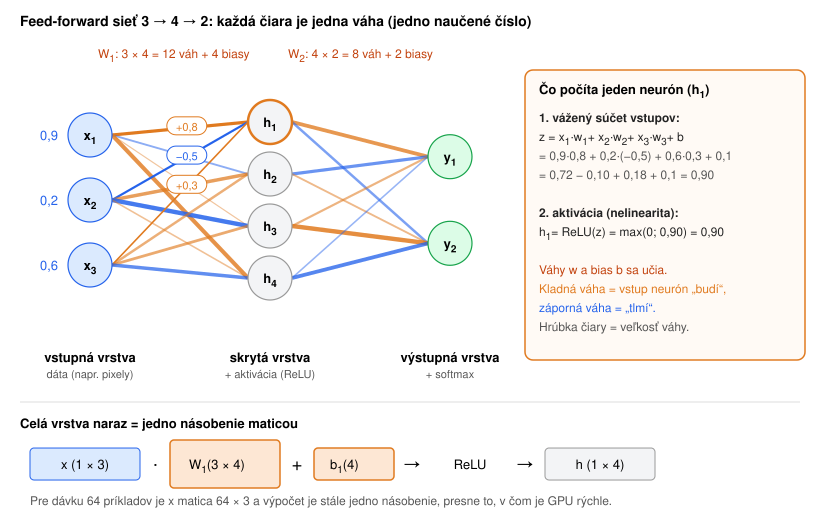
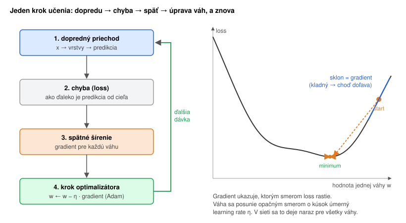
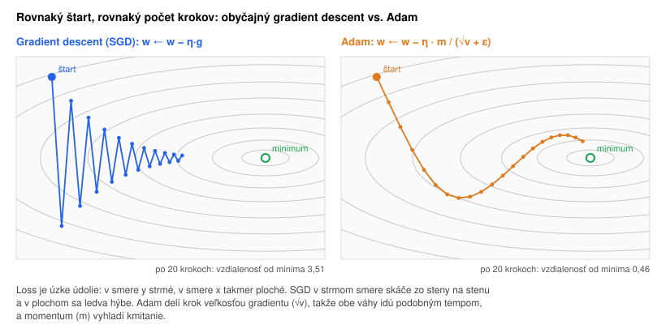
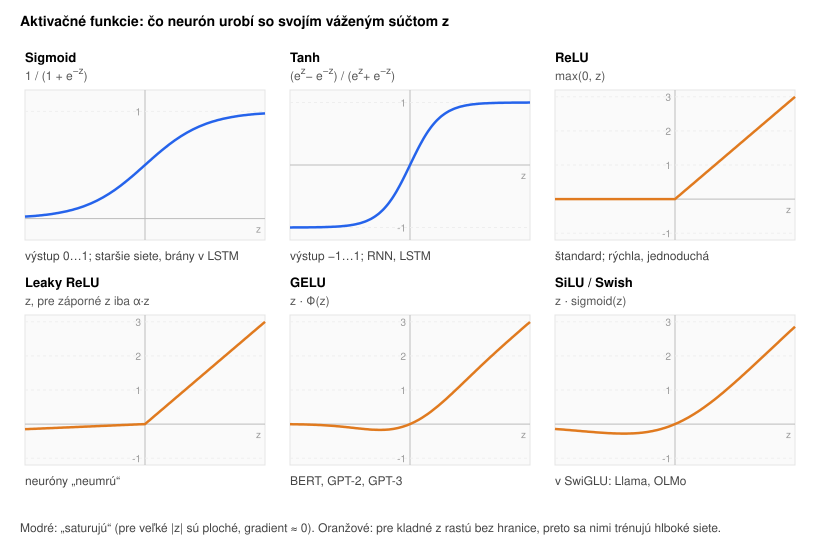

# Neurónové siete – feed-forward sieť a ako sa učí

Predtým, než sa pozrieme dovnútra transformera ([transformer-topology.md](2_transformer-topology.md)), treba poznať jeho najmenší stavebný kameň: **feed-forward sieť** (FFN, dopredná sieť, niekedy aj MLP). Všetko, čo platí tu, platí aj pre LLM, len s väčšími číslami. Naživo, vrátane vzorcov v kóde, si to dá vyskúšať v cvičení [rozpoznávanie číslic](cvicenie/rozpoznavanie-obrazkov.md). Pojmy sú v [slovníku](slovnik.md).

## Neurón a váhy



**Neurón** robí iba dve veci:

1. **Vážený súčet:** každý vstup vynásobí jeho **váhou**, výsledky sčíta a pripočíta **bias** (posun): `z = x₁·w₁ + x₂·w₂ + x₃·w₃ + b`.
2. **Aktivácia:** na `z` použije nelineárnu funkciu, napríklad `ReLU(z) = max(0, z)`.

Váha hovorí, ako veľmi a ktorým smerom daný vstup ovplyvní neurón. **Kladná** váha neurón „budí“, **záporná** ho „tlmí“, váha blízko nuly znamená, že na vstupe nezáleží. Váhy a biasy sú **parametre** siete. Na začiatku sú náhodné a tréning ich nastaví.

**Vrstva** je skupina neurónov, ktoré dostanú rovnaké vstupy. **Feed-forward** znamená, že dáta tečú iba jedným smerom, od vstupu k výstupu:

- **vstupná vrstva** sú samotné dáta (napríklad 784 pixelov obrázka),
- **skryté vrstvy** postupne vytvárajú užitočnejšie reprezentácie,
- **výstupná vrstva** dá výsledok, napríklad skóre pre každú z 10 číslic. **Softmax** z nich spraví pravdepodobnosti so súčtom 1.

### Vrstva = násobenie maticou

Všetky váhy medzi dvoma vrstvami tvoria **maticu W**. Celú vrstvu tak vypočíta jeden riadok:

```
h = aktivácia(x · W + b)
```

Pri dávke 64 príkladov je `x` matica 64 × vstupy a výpočet je stále jedno maticové násobenie. Práve na to sú GPU stavané.

**Počet parametrov** je súčet veľkostí všetkých matíc a biasov. Sieť z cvičenia 784 → 128 → 64 → 10 má:

| Vrstva | Váhy | Biasy | Spolu |
|---|---|---|---|
| 784 → 128 | 100 352 | 128 | 100 480 |
| 128 → 64 | 8 192 | 64 | 8 256 |
| 64 → 10 | 640 | 10 | 650 |
| **spolu** | | | **109 386** |

Pre porovnanie: jedna FFN v jednom bloku OLMo 2 7B má ~135 miliónov parametrov a blokov je 32.

**Prečo nelinearita:** bez aktivačnej funkcie by bola každá vrstva iba násobením maticou. Dve násobenia za sebou sa dajú nahradiť jedným, takže sto vrstiev by nevedelo viac než jedna. Nelinearita medzi vrstvami umožní skladať jednoduché „ohyby“ do ľubovoľne zložitých tvarov.

## Ako sa sieť učí



Učenie je opakovanie štyroch krokov:

1. **Dopredný priechod (forward pass):** dávka príkladov prejde sieťou a vznikne predikcia.
2. **Chyba (loss):** jedno číslo, ktoré hovorí, ako veľmi sa predikcia líši od správnej odpovede. Pri klasifikácii sa používa **cross-entropy** `−log P(správna odpoveď)`. Ak sieť dala správnej odpovedi 99 %, loss je ≈ 0,01. Ak 1 %, loss je ≈ 4,6. Najviac sa teda trestajú **sebavedomé omyly**. Prečo práve softmax a `−log`, s príkladom na 10 výstupoch, je v [softmax a cross-entropy](cvicenie/softmax-cross-entropy.md).
3. **Spätné šírenie (backpropagation):** pre **každú** váhu sa vypočíta **gradient**, teda o koľko by sa zmenil loss, keby sa váha trochu zväčšila.
4. **Krok optimalizátora:** každá váha sa posunie o kúsok **proti** gradientu, aby loss klesol.

Potom sa vezme ďalšia dávka a ide sa znova. Jeden prechod cez všetky trénovacie dáta sa volá **epocha**.

### Gradient descent – zostup z kopca

Predstavme si loss ako krajinu, kde poloha je nastavenie všetkých váh a výška je chyba. Gradient ukazuje smer, ktorým krajina **najstrmšie stúpa**, takže sa ide opačne:

```
w ← w − η · gradient
```

**η (learning rate)** určuje veľkosť kroku. Príliš malý znamená, že učenie trvá večnosť. Príliš veľký znamená, že sieť preskakuje údolie a loss skáče alebo „vybuchne“.

Gradient sa nepočíta z celého datasetu naraz, ale z **mini-batchu** (napr. 64 príkladov). Odhad je trochu zašumený, ale kroky sú oveľa rýchlejšie.

### Backpropagation – chyba ide späť

Na výstupe je gradient jednoduchý: pri softmax + cross-entropy je to presne **`predikcia − skutočnosť`**. Ak je správna odpoveď „3“ a sieť jej dala 0,7, gradient trojky je −0,3 („zvýš“). Táto chyba sa potom pošle späť cez tie isté váhy, vrstvu po vrstve. Váha, ktorá k chybe prispela viac, dostane väčší podiel viny.

Gradienty všetkých váh sa tak získajú naraz, jedným prechodom sieťou odzadu, a stojí to len asi dvakrát toľko ako dopredný priechod. Preto sa dajú trénovať aj siete s miliardami váh. V PyTorchi to robí jeden riadok `loss.backward()`.

### Optimalizátor Adam



Obyčajný gradient descent posúva všetky váhy rovnakým krokom. Krajina lossu je však v niektorých smeroch strmá a v iných plochá. V strmom smere krok preskočí údolie a kmitá, v plochom sa sieť takmer nehýbe.

**Adam** si pre **každú váhu zvlášť** pamätá dve čísla:

- **momentum**: kĺzavý priemer gradientu, teda „ktorým smerom sa dlhodobo ide“. Funguje ako zotrvačnosť guľe, ktorá sa kotúľa z kopca.
- **veľkosť gradientov**: váha s veľkými gradientmi sa posúva opatrnejšie, váha s malými rýchlejšie. Každá váha má tak vlastný, automaticky nastavený krok.

**AdamW** pridáva **weight decay** (v každom kroku sa váhy trochu stiahnu k nule) a trénujú sa ním prakticky všetky LLM. Vzorce sú v kóde cvičenia (`_apply_adam()`).

**Cena:** Adam drží pre každú váhu dve ďalšie čísla. Spolu s váhou a gradientom sú to 4 čísla na parameter. Preto tréning 7B modelu potrebuje ~16 B na parameter, teda viac ako 100 GB pamäte, kým inferencia iba ~2 B na parameter (pozri [olmo.md](priloha_olmo.md)).

## Aktivačné funkcie



Staršie siete používali **sigmoid** a **tanh**. Tie sú pre veľké vstupy ploché, gradient sa pri prechode mnohými vrstvami zmenší takmer na nulu (**miznúci gradient**) a prvé vrstvy sa prestanú učiť. Dnes sa používa **ReLU** `max(0, z)` a jej hladké verzie **GELU** a **SiLU**, ktoré tento problém nemajú.

### SwiGLU – aktivácia v dnešných LLM

FFN v transformeri má tri matice namiesto dvoch. Jedna vetva sa pošle cez SiLU a funguje ako **brána (gate)**, ktorá určí, koľko z druhej vetvy prejde:

```
FFN(x) = ( SiLU(x · W_gate) ⊙ (x · W_up) ) · W_down          (⊙ = násobenie prvok po prvku)
```

V OLMo 2 7B je `x` vektor 4096 čísel, `W_gate` a `W_up` ho rozšíria na 11 008 a `W_down` zúži späť na 4096 (pozri [FFN – každý token sám za seba](2_transformer-topology.md#ffn--každý-token-sám-za-seba)).

## Generalizácia a preučenie

Cieľom nie je nízky loss na trénovacích dátach, ale správne odpovede na dátach, ktoré sieť **nikdy nevidela**. Preto sa dáta delia na tri časti:

- **trénovacie**: na nich sa upravujú váhy,
- **validačné**: podľa nich sa vyberá architektúra, learning rate a moment, kedy prestať,
- **testovacie**: použijú sa iba raz na konci, aby výsledné číslo bolo poctivé.

**Preučenie (overfitting)** nastane, keď sa sieť namiesto všeobecných pravidiel naučí naspamäť konkrétne príklady. Presnosť na trénovacích dátach rastie, na validačných stojí alebo klesá.

Druhá lekcia z cvičenia: sieť sa naučí **rozloženie dát**, nie „pojem“. Číslica nakreslená inak, než vyzerajú trénovacie dáta, sa rozpozná zle, aj keď má sieť na teste 97 %. LLM na tom nie sú inak: najlepšie fungujú na úlohách, ktoré sa podobajú na to, čo bolo v trénovacích dátach (pozri [ai_constraints.md](4_ai_constraints.md)).

## Od malej siete k LLM

| | Sieť z cvičenia (MNIST) | OLMo 2 7B |
|---|---|---|
| vstup | 784 pixelov | vektor tokenu (4096 čísel) |
| FFN | 784 → 128 → 64 → 10 | v každom z 32 blokov 4096 → 11 008 → 4096 |
| aktivácia | ReLU / Leaky ReLU | SwiGLU (SiLU) |
| výstup | softmax cez 10 číslic | softmax cez 100 352 tokenov |
| loss | cross-entropy | cross-entropy na ďalšom tokene |
| optimalizátor | Adam | AdamW |
| parametre | ~109 tisíc | ~7,3 miliardy |

Princíp je rovnaký: **maticové násobenia + nelinearita + gradient + Adam**. Transformer k tomu pridáva attention, aby si tokeny mohli vymieňať informácie.
