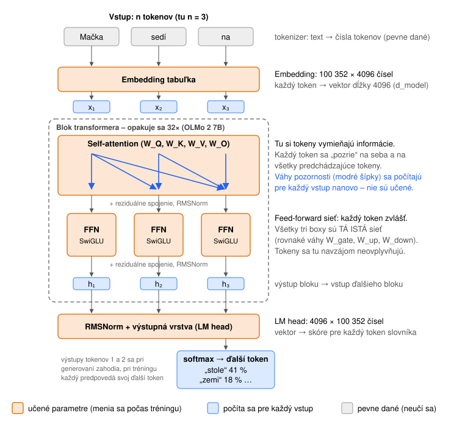
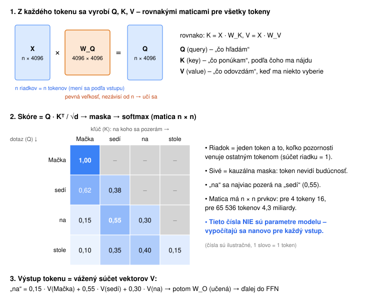
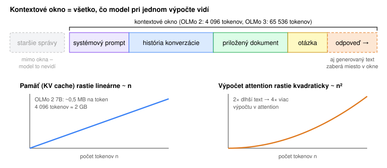
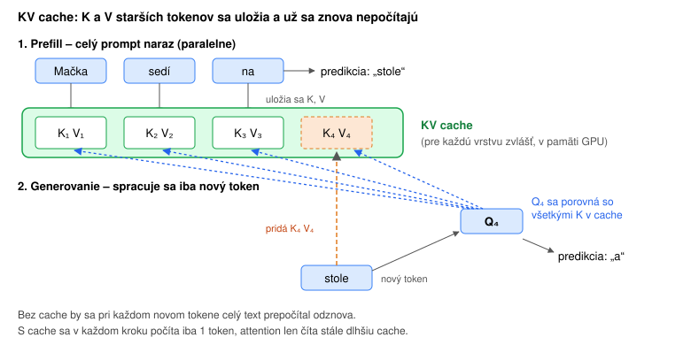

# Topológia transformera – ako to vnútri funguje

Moderné jazykové modely (GPT, Llama, Claude, OLMo) sú **decoder-only transformery**. Čísla v príkladoch sú pre **OLMo 2 7B** (pozri [olmo.md](priloha_olmo.md)). Základy (neurón, váhy, učenie, Adam, aktivačné funkcie) sú v [neuronove-siete.md](1_neuronove-siete.md), pojmy v [slovníku](slovnik.md).

## Cesta textu modelom

1. **Tokenizer** rozdelí text na tokeny (kúsky slov) a každý nahradí číslom. Tokenizer sa natrénuje vopred, ešte pred modelom (algoritmus BPE spočíta časté kúsky textu), a počas tréningu modelu sa už nemení.
2. **Embedding:** každý token sa v tabuľke (100 352 riadkov × 4096) zmení na vektor 4096 čísel. Z textu s *n* tokenmi vznikne matica **n × 4096**.
3. **32 rovnako stavaných blokov**, každý s vlastnými váhami. Každý blok má dve časti:
   - **self-attention**: tokeny si vymieňajú informácie,
   - **feed-forward sieť (FFN)**: každý token sa spracuje **sám, nezávisle od ostatných**.
4. **Výstupná vrstva (LM head)** zmení vektor posledného tokenu na skóre pre každý zo 100k tokenov slovníka. Softmax z nich spraví pravdepodobnosti. Ďalší token sa z nich **vylosuje** a mieru náhody určuje **teplota**. Preto rovnaká otázka môže dostať rôzne odpovede (podrobne v [trening-a-inferencia.md](3_trening-a-inferencia.md)).

### Tokeny a embeddingy

Model nečíta písmená ani celé slová, ale **tokeny**. Tokenizer má pevný slovník častých kúskov textu (~100 000 položiek) a text poskladá z čo najdlhších známych kúskov. Takto to vyzerá s tokenizérom `cl100k`, z ktorého vychádza aj OLMo 2:

| Text | Tokeny | Počet |
|---|---|---|
| The cat is sitting on the table. | `The` · ` cat` · ` is` · ` sitting` · ` on` · ` the` · ` table` · `.` | 8 |
| Mačka sedí na stole. | `Ma` · `č` · `ka` · ` sed` · `í` · ` na` · ` stole` · `.` | 8 |

Anglická veta má jeden token na slovo, slovenská dva tokeny na slovo. Pri takejto krátkej vete vyjde počet tokenov rovnako, lebo slovenská veta má vďaka pádom menej slov (4 namiesto 7). Pri dlhšom texte s rovnakým obsahom je rozdiel zreteľný:

| Text | Slová | Tokeny |
|---|---|---|
| The model reads the whole conversation again on every request, so a long chat costs more and the answers get worse over time. | 23 | 25 |
| Model pri každej požiadavke znova číta celú konverzáciu, takže dlhý chat stojí viac a odpovede sa časom zhoršujú. | 18 | 49 |

Slovenčiny je v trénovacích dátach málo, preto v slovníku nie sú celé slovenské slová. Ten istý obsah je pre model po slovensky zhruba dvakrát dlhší a v kontextovom okne zaberie viac miesta.

**Embedding** je tabuľka, v ktorej má každý token naučený vektor 4096 čísel. Na začiatku sú vektory náhodné. Tréning ich posunie tak, že tokeny s podobným významom a použitím („mačka“, „pes“) majú podobné vektory.

Počas celej cesty má každý token svoj vlastný vektor dĺžky 4096. Bloky tento vektor postupne „obohacujú“ o význam, kontext a súvislosti.

## Attention – ako sa tokeny navzájom vidia

Attention je **jediné miesto v modeli, kde sa tokeny navzájom ovplyvňujú.**

Pre každý token sa z jeho vektora vyrobia tri nové vektory:

- **Q (query)** – „čo hľadám“,
- **K (key)** – „čo ponúkam“, teda podľa čoho ma ostatní nájdu,
- **V (value)** – „akú informáciu odovzdám“, keď si ma niekto vyberie.

Potom:

1. Každý token porovná svoje **Q** s **K** všetkých tokenov (skalárny súčin). Čím je výsledok väčší, tým je druhý token relevantnejší.
2. **Kauzálna maska** zakáže pozerať sa na tokeny vpravo (do budúcnosti). Model generuje zľava doprava, takže budúcnosť ešte nepozná.
3. **Softmax** zmení skóre na váhy, ktoré dávajú súčet 1.
4. Výstup tokenu je **vážený súčet vektorov V**. Napríklad „na“ si zoberie 55 % informácie od „sedí“, 30 % od seba a 15 % od „Mačka“.

**Poradie slov:** samotný výpočet Q · K nevie, či je token blízko alebo ďaleko. Pre attention by „10 − 3“ a „3 − 10“ (alebo anglické „dog bites man“ a „man bites dog“) boli rovnaké: tie isté tokeny, len v inom poradí. Slovenský príklad typu „pes hryzie muža“ by nefungoval, lebo pády menia samotné tokeny (muža/muž, psa/pes). Pozíciu preto dodáva **RoPE**: vektory Q a K sa pred porovnaním „otočia“ o uhol podľa pozície tokenu, takže skóre závisí aj od toho, ako ďaleko od seba tokeny sú.

**Viac hláv (multi-head):** v jednej vrstve beží 32 takýchto attention paralelne, každá s vektormi dĺžky 128. Každá hlava sa môže naučiť sledovať iný vzťah, napríklad podmet a prísudok, predchádzajúce slovo alebo zátvorky. Výsledky hláv sa spoja a prejdú maticou **W_O**.

## FFN – každý token sám za seba

Po attention ide vektor každého tokenu do **feed-forward siete**: rozšíri sa zo 4096 na 11 008 čísel, prejde nelineárnou funkciou (SwiGLU) a zúži sa späť na 4096. Je to presne taká sieť, ako je popísaná v [neuronove-siete.md](1_neuronove-siete.md), len väčšia.

- Je to **tá istá sieť s rovnakými váhami** pre všetky tokeny.
- Každý token sa spracuje **nezávisle**. Ostatné tokeny tu nevidí, všetko, čo o nich vie, získal v attention.
- FFN obsahuje približne **2/3 všetkých parametrov** modelu. Predpokladá sa, že tu je uložená väčšina „vedomostí“ (fakty, vzory).

Zjednodušene: **attention zbiera informácie od ostatných tokenov, FFN ich spracuje.** Toto sa zopakuje 32-krát.

## Čo znamenajú jednotlivé matice W

Najprv jeden pojem: vektor tokenu, ktorý ide cez bloky, sa volá **reziduálny prúd** (residual stream). Bloky ho neprepisujú, iba k nemu **pripočítavajú** svoj príspevok (`x = x + attention(x)`, `x = x + FFN(x)`). Funguje ako spoločná „pracovná plocha“, na ktorú každá vrstva dopíše, čo zistila.

Každá matica je naučená **transformácia**: vynásobením vektora maticou sa z neho vytiahne alebo vytvorí iný druh informácie.

| Matica | Veľkosť (OLMo 2 7B) | Čo robí |
|---|---|---|
| **Embedding** | 100 352 × 4096 | Pre každý token slovníka uložený vektor, „súradnice významu“. Podobné slová (mačka, pes) majú podobné vektory. |
| **W_Q** (query) | 4096 × 4096 | Z vektora tokenu vyrobí **otázku**: aký druh informácie tento token práve potrebuje. Napríklad sloveso „hľadá“ svoj podmet. |
| **W_K** (key) | 4096 × 4096 | Vyrobí **štítok**: aký druh informácie tento token ponúka. Napríklad „som podstatné meno, podmet, živé“. Ak sa Q jedného tokenu podobá na K druhého, vznikne vysoké skóre. |
| **W_V** (value) | 4096 × 4096 | Vyrobí **obsah**, ktorý token odovzdá tomu, kto si ho vyberie. Nemusí to byť to isté ako štítok: podľa K ťa nájdu, cez V odovzdáš informáciu. |
| **W_O** (output) | 4096 × 4096 | Spojí výsledky všetkých 32 hláv a zapíše ich späť do reziduálneho prúdu. |
| **W_up** | 4096 × 11 008 | Rozšíri vektor do väčšieho priestoru, kde každý z 11 008 prvkov funguje ako **detektor** nejakého vzoru („hovorí sa o Paríži“, „toto je kód v Pythone“…). |
| **W_gate** | 4096 × 11 008 | Pre každý detektor rozhodne, **koľko z neho prepustiť** (SwiGLU: `SiLU(x·W_gate) ⊙ (x·W_up)`). |
| **W_down** | 11 008 × 4096 | Z aktivovaných detektorov poskladá výsledok a pripočíta ho do reziduálneho prúdu. Tu sa „zapisujú vedomosti“, napríklad „Paríž → hlavné mesto Francúzska“. |
| **RMSNorm / QK-norm** | vektor 4096 | Udržiavajú čísla v rozumnom rozsahu, aby tréning nebol nestabilný. Učí sa iba váha pre každý rozmer. |
| **LM head** | 4096 × 100 352 | Opak embeddingu. Porovná výsledný vektor s každým tokenom slovníka a dá mu skóre (logit). |

Tieto popisy sú **zjednodušené**. Nikto modelu nepovedal, že W_K má značiť „podmet“. Model si úlohy matíc našiel sám počas tréningu a jednotlivé rozmery často kódujú zmes viacerých vecí naraz. Výskum interpretovateľnosti však potvrdzuje, že takéto „detektory“ a „vyhľadávacie hlavy“ v modeloch naozaj vznikajú.

## Prečo môže mať vstup rôzny počet tokenov

Žiadna učená matica **nezávisí od počtu tokenov n**. W_Q, W_K, W_V, W_O sú 4096 × 4096, FFN matice 4096 × 11 008, embedding a LM head 100 352 × 4096 (tabuľka vyššie).

Tie isté matice sa aplikujú na každý token zvlášť, podobne ako jeden recept na ľubovoľný počet porcií. Od *n* závisí iba to, **čo sa počíta počas behu**: matica X (n × 4096) a matica pozornosti (n × n). Tie sa vytvoria pre každý vstup nanovo a potom zahodia.

Preto model spracuje vstup s 5 tokenmi aj s 5 000 tokenmi s tými istými váhami.

## Čo je teda kontextové okno

**Kontextové okno je maximálny počet tokenov, ktoré model spracuje naraz.** Patrí doň **všetko**: systémový prompt, celá história konverzácie, priložené dokumenty, otázka a **aj odpoveď, ktorú model práve generuje**.

Ak váhy od *n* nezávisia, prečo je vôbec nejaký limit? Z troch dôvodov:

1. **Model sa to nenaučil.** Pozícia tokenu sa do attention dostáva cez RoPE. Ak model počas tréningu nikdy nevidel texty dlhšie ako 4 096 tokenov, nevie pracovať s väčšími vzdialenosťami a kvalita sa rýchlo rozpadne. Dlhý kontext sa preto musí trénovať (OLMo 3 má na to samostatnú fázu, po ktorej zvláda 65 536 tokenov).
2. **Výpočet rastie kvadraticky.** Matica pozornosti má n × n prvkov. Dvakrát dlhší text znamená štyrikrát viac výpočtu v attention.
3. **Pamäť rastie lineárne.** Pri generovaní si model pre každý token a každú vrstvu pamätá jeho K a V (tzv. **KV cache**). Pri OLMo 2 7B je to ~0,5 MB na token, takže 4 096 tokenov zaberie ~2 GB a 65k tokenov by zabralo ~32 GB.

**Dôležité dôsledky:**

- Model **nemá pamäť medzi volaniami**. Chatbot si „pamätá“ konverzáciu len preto, že sa mu celá história pošle znova pri každej otázke.
- Pri generovaní sa každý nový token pridá na koniec a kontext sa zväčší o 1. Model generuje token po tokene a pri každom „vidí“ všetko pred ním.
- Čo sa do okna nezmestí, model **vôbec nevidí**. Aplikácie preto staré správy orezávajú alebo sumarizujú.

### Prečo sa dlhý kontext zhoršuje, aj keď sa doň zmestí

Že sa text do okna zmestí, ešte neznamená, že ho model využije rovnako dobre ako krátky. Coding agenti tomu hovoria **context rot**. Dôvody vyplývajú priamo z architektúry:

1. **Pozornosť sa delí.** Softmax v attention rozdelí váhy so súčtom 1 medzi **všetky** tokeny v kontexte. Pri 500 tokenoch dostane dôležitá veta veľký podiel. Pri 100 000 tokenoch jej konkurujú tisíce podobne vyzerajúcich riadkov (logy, staré pokusy, nepotrebné súbory) a podiel sa rozriedi.
2. **Dlhé texty boli v tréningu zriedkavé.** Väčšina trénovacích dokumentov je krátka a dlhý kontext sa dotrénuje iba v krátkej fáze na konci (OLMo 3: 100B z ~6T tokenov). Model teda s veľkými vzdialenosťami pracuje menej spoľahlivo.
3. **Stratené v strede (lost in the middle).** Modely najlepšie využívajú začiatok kontextu (systémový prompt, zadanie) a koniec (posledné správy). Informácia uprostred dlhého kontextu sa prehliadne najčastejšie.
4. **Šum ťahá odpoveď.** Všetko v kontexte ovplyvňuje ďalší token. Starý neúspešný pokus alebo nesúvisiaci kód model „inšpiruje“, aj keď už neplatí.

Dôsledok pre prácu s agentmi: **menej, ale relevantného kontextu je lepšie ako veľa.** Preto agenti čítajú súbory cielene, posielajú prieskum do subagentov a dlhú konverzáciu sumarizujú (podrobne v [kapitole 5](5_od-modelu-k-agentovi.md#kontext-ako-pracovná-pamäť-agenta)).

## KV cache – prečo sa vstup nepočíta stále odznova

Model generuje odpoveď po jednom tokene a každý nový token potrebuje attention na všetky predchádzajúce. Bez triku by sa pri každom novom tokene musel celý text prepočítať odznova.

Vďaka kauzálnej maske sa však **K a V starého tokenu už nikdy nezmenia**, lebo token nevidí to, čo prišlo po ňom. Dajú sa teda raz vypočítať a uložiť:

1. **Prefill:** celý prompt sa spracuje naraz, paralelne. Pre každý token a každú vrstvu sa K a V uložia do **KV cache**. Táto fáza je rýchla, lebo GPU počíta všetky tokeny naraz.
2. **Decode (generovanie):** pre nový token sa vypočíta iba jeho Q, K a V. Jeho K a V sa pridajú do cache a jeho Q sa porovná so všetkými K v cache. Spracuje sa teda **jeden token** namiesto celého textu.

**Praktické dôsledky:**
- Dlhý prompt spomalí najmä začiatok odpovede (prefill). Samotné generovanie je obmedzené hlavne rýchlosťou pamäte, lebo v každom kroku treba prečítať všetky váhy a celú cache.
- Cache zaberá veľa pamäte GPU (~0,5 MB na token pri OLMo 2 7B). Preto vznikli úspornejšie varianty:
  - **GQA:** viac hláv zdieľa rovnaké K a V. OLMo 2 32B má 8 KV hláv namiesto 40, takže cache je 5× menšia.
  - **Sliding window:** niektoré vrstvy si držia iba posledných 4 096 tokenov (v OLMo 3 tri zo štyroch vrstiev, štvrtá vidí celý kontext).
- **Prompt caching** u poskytovateľov API je to isté vo väčšom: KV cache pre opakujúci sa začiatok promptu (napr. dlhý systémový prompt) sa uloží a použije pri ďalších požiadavkách, čo je lacnejšie aj rýchlejšie.

## Čo sa učí a čo nie

**Učené parametre** (menia sa počas tréningu, na obrázkoch oranžové):

| Časť | Parametre | Počet (OLMo 2 7B) |
|---|---|---|
| Embedding tabuľka | vektor pre každý token slovníka | ~0,41B |
| Attention (v každom bloku) | W_Q, W_K, W_V, W_O | 67M × 32 = ~2,1B |
| FFN (v každom bloku) | W_gate, W_up, W_down | 135M × 32 = ~4,3B |
| Normalizácie | váhy RMSNorm a QK-norm (vektory) | zanedbateľné |
| LM head | výstupná matica | ~0,41B |
| **Spolu** | | **~7,3B** |

**Neučí sa, počíta sa pre každý vstup** (modré):
- vektory Q, K, V konkrétnych tokenov,
- matica pozornosti (kto sa na koho pozerá a koľko),
- medzivýsledky vrstiev a KV cache.

**Neučí sa, je pevne dané** (sivé):
- tokenizer, kauzálna maska, vzorec RoPE, aktivačné funkcie.

**Hyperparametre** volia ľudia pred tréningom, model ich nemení: počet vrstiev (32), d_model (4096), počet hláv (32), veľkosť FFN (11 008), veľkosť slovníka a dĺžka kontextu.

Tréning teda znamená iba jedno: nastaviť ~7,3 miliardy čísel v oranžových maticiach tak, aby model čo najlepšie predpovedal ďalší token.

## Dve varianty, ktoré stretnete v praxi

**MoE (Mixture of Experts).** Namiesto jednej veľkej FFN má každý blok napríklad 64 menších FFN („expertov“) a malý **router**, ktorý pre každý token vyberie iba niekoľko z nich (napr. 8). Model má teda veľa parametrov (veľa vedomostí), ale na jeden token sa ich použije len zlomok (rýchlosť a cena). Preto sa pri MoE uvádzajú dve čísla, napríklad „7B celkovo, 1B aktívnych“ (OLMoE). Väčšina dnešných veľkých open-weight modelov (DeepSeek, Qwen, Kimi) je MoE. Komerční poskytovatelia architektúru svojich modelov nezverejňujú. Pamäť GPU však musí udržať **všetkých** expertov, nie iba aktívnych.

**Kvantizácia.** Váhy sa pri tréningu ukladajú ako 16-bitové čísla, takže 7B model zaberie ~14 GB. Pri inferencii sa dajú zaokrúhliť na 8 alebo 4 bity s malou stratou kvality. 7B model v 4 bitoch má ~4 GB a beží aj na notebooku. Takto fungujú lokálne nástroje ako **Ollama** alebo **llama.cpp** (formát GGUF). Lokálny model sa hodí tam, kde dáta nesmú opustiť firmu, no kvalitou zaostáva za frontier modelmi (pozri [olmo.md](priloha_olmo.md#porovnanie-výkonu)).
