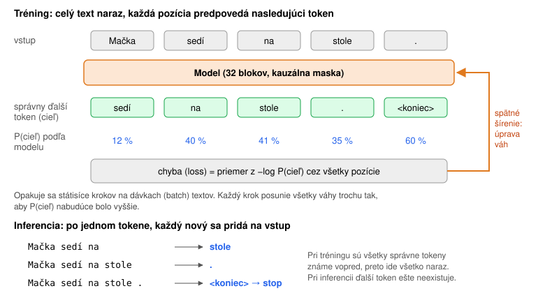
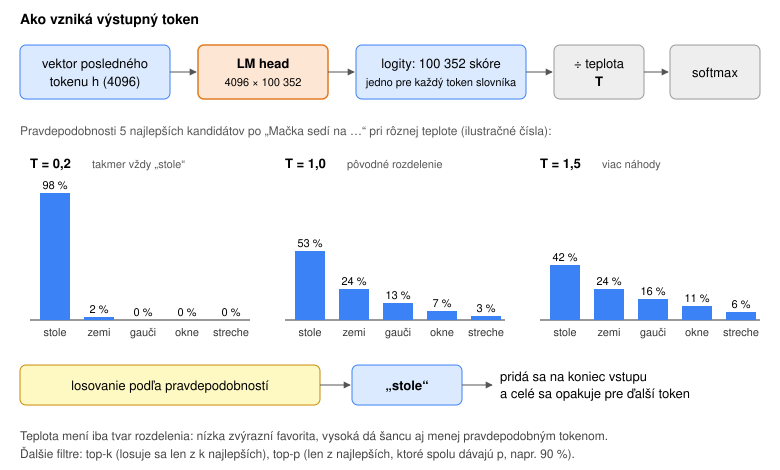
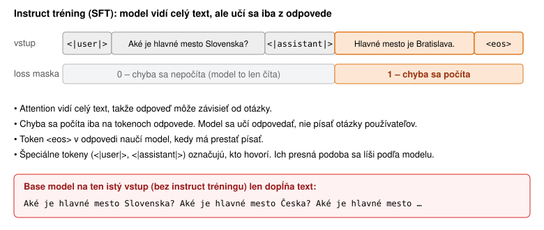
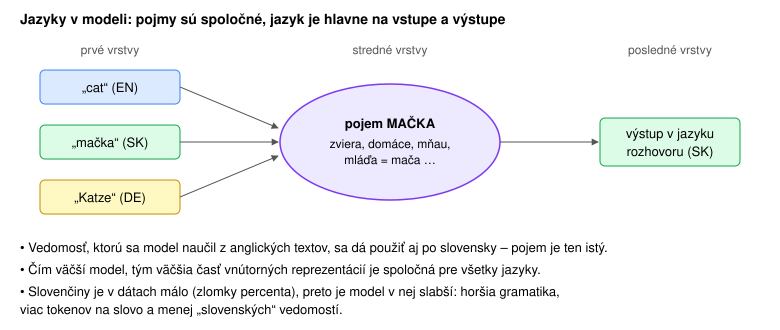
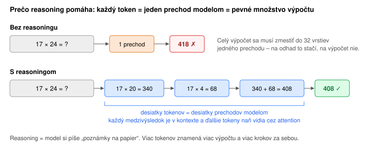

# Tréning a inferencia – ako sa model učí a ako odpovedá

Nadväzuje na [transformer-topology.md](2_transformer-topology.md). Tu je popísané, čo sa s modelom deje počas učenia a počas používania. Pojmy sú v [slovníku](slovnik.md).

## Tréning: predpovedanie ďalšieho tokenu



Model sa učí jedinú úlohu: **predpovedať ďalší token**.

1. Zoberie sa kus textu, napríklad „Mačka sedí na stole.“
2. Model ho spracuje **celý naraz**. Na každej pozícii vypočíta pravdepodobnosti ďalšieho tokenu.
3. Pravdepodobnosti sa porovnajú so skutočným ďalším tokenom. **Chyba (loss)** je tým menšia, čím vyššiu pravdepodobnosť model dal správnemu tokenu (presnejšie −log P).
4. **Spätné šírenie (backpropagation)** vypočíta pre každú z ~7 miliárd váh, ktorým smerom ju treba posunúť, aby chyba klesla. Optimalizátor (AdamW) ich o malý kúsok posunie. Je to ten istý postup ako pri malej sieti v [neuronove-siete.md](1_neuronove-siete.md#ako-sa-sieť-učí).
5. Opakuje sa to státisíce krokov na dávkach s miliónmi tokenov, kým model neprejde biliónmi tokenov.

Jedna veta je teda zároveň veľa úloh naraz: „Mačka → sedí“, „Mačka sedí → na“, „Mačka sedí na → stole“… Vďaka **kauzálnej maske** sa model na žiadnej pozícii nemôže pozrieť na odpoveď, ktorá je hneď vedľa, a všetky pozície sa dajú trénovať paralelne. Preto je tréning na GPU taký efektívny.

Nikto modelu nevysvetľuje gramatiku ani fakty. Aby vedel dobre predpovedať ďalší token v biliónoch textov, musí si sám vytvoriť vnútorný model jazyka, sveta a uvažovania.

## Inferencia: odpoveď token po tokene

**Inferencia** je používanie natrénovaného modelu. Váhy sú pevné a nič sa neučí.



1. Prompt sa spracuje naraz (**prefill**) a K a V všetkých tokenov sa uložia do KV cache (pozri [KV cache](2_transformer-topology.md#kv-cache--prečo-sa-vstup-nepočíta-stále-odznova)).
2. Vektor **posledného** tokenu prejde cez LM head, ktorý vráti 100 352 skóre (logitov), jedno pre každý token slovníka.
3. Logity sa vydelia **teplotou** a softmax z nich spraví pravdepodobnosti.
4. Z pravdepodobností sa **vylosuje** jeden token.
5. Token sa pridá na koniec vstupu a pokračuje sa krokom 2. Končí sa, keď model vygeneruje token `<eos>` (koniec) alebo keď sa dosiahne limit dĺžky.

### Prečo sa predikuje iba jeden token

- Model je **natrénovaný** vracať rozdelenie pravdepodobností práve pre jeden nasledujúci token.
- Druhý token **závisí od toho, ktorý prvý sa vybral**. Ak sa po „Mačka sedí na“ vylosuje „stole“, ďalej príde niečo iné, než keby sa vylosovalo „streche“. Kým nie je jasný prvý token, druhý sa nedá rozumne predpovedať.
- Odpoveď vzniká ako reťaz rozhodnutí. Každé rozhodnutie mení, čo nasleduje, a model pri každom ďalšom tokene vidí všetky predchádzajúce.

Existujú triky na zrýchlenie, napríklad **speculative decoding**: malý model navrhne niekoľko tokenov a veľký ich overí naraz. Výsledok je však rovnaký, akoby sa generovalo po jednom.

### Teplota a prečo rovnaká otázka dáva rôzne odpovede

**Teplota (temperature)** určuje, ako veľmi sa pri losovaní uprednostní najpravdepodobnejší token:

| Teplota | Správanie | Použitie |
|---|---|---|
| **0** | vždy sa vyberie najpravdepodobnejší token (greedy) | extrakcia dát, klasifikácia, kód |
| **0,2 – 0,7** | prevažne favorit, občas iná voľba | väčšina faktických úloh |
| **~1** | pôvodné rozdelenie modelu | chat, všeobecné použitie |
| **> 1** | aj menej pravdepodobné tokeny majú šancu, viac kreativity a viac chýb | brainstorming, poézia |

Ďalšie filtre: **top-k** losuje iba z k najlepších tokenov, **top-p** iba z najlepších tokenov, ktoré spolu dávajú pravdepodobnosť p (napr. 90 %). Odfiltrujú „chvost“ nezmyselných tokenov.

> **Pozor pri Claude API (stav 10/2026):** od 21. 10. 2026 Claude API parametre `temperature`, `top_p` a `top_k` neprijíma, request s nimi skončí chybou 400. Pri Claude sa správanie riadi parametrom `effort`, promptom a štruktúrovaným výstupom. Princíp teploty platí ďalej a nastaviť ju dá napríklad pri otvorených modeloch (OLMo, Llama) a u iných poskytovateľov.

**Prečo rovnaká otázka dáva rôzne odpovede:**
- Pri teplote > 0 sa ďalší token **losuje**. Stačí, že sa na začiatku vylosuje iné slovo, napríklad „Áno, …“ namiesto „To závisí …“, a zvyšok odpovede pokračuje úplne inou cestou.
- Ani pri teplote 0 to nemusí byť úplne deterministické. GPU sčítava čísla v rôznom poradí podľa toho, koľko požiadaviek práve počíta naraz, a drobné zaokrúhľovacie rozdiely môžu zmeniť výber pri dvoch takmer rovnako pravdepodobných tokenoch.
- Variabilita je **vlastnosť, nie chyba**. Ak je dôležitá stabilita, používa sa nízka teplota (kde ju API dovolí), presný prompt a štruktúrovaný výstup.

## Instruct tréning: ako sa z dopĺňača textu stane asistent

Base model po pretrainingu vie iba **dopĺňať text**. Na otázku „Aké je hlavné mesto Slovenska?“ môže pokojne pokračovať ďalšími otázkami, lebo na internete také zoznamy otázok bežne sú.

Odpoveď na otázku nie je obyčajné pokračovanie textu. Model sa musí naučiť **rolu**: kto hovorí, kedy začína odpoveď, ako má vyzerať a kedy skončiť. Na to slúži **SFT (supervised fine-tuning)** na rozhovoroch:



1. Rozhovor sa zapíše do **chat šablóny** so špeciálnymi tokenmi, ktoré označujú role (používateľ, asistent, systém). Rovnaká šablóna sa potom musí použiť aj pri inferencii. Pre model je to stále jeden súvislý text, napríklad (zjednodušená šablóna OLMo):
   ```
   <|system|>Si stručný asistent.
   <|user|>Aké je hlavné mesto Slovenska?
   <|assistant|>Bratislava.<|endoftext|>
   ```
   Rovnakým spôsobom sa model naučí aj **volať nástroje**: definície nástrojov a ich volania sú ďalšie časti tohto textu so svojimi značkami (podrobne v [kapitole 5](5_od-modelu-k-agentovi.md#volanie-nástroja-je-tiež-len-text)).
2. Tréning je **rovnaký ako pri pretrainingu** (predpovedanie ďalšieho tokenu), s jedným rozdielom: **maskovanie lossu**.
3. Chyba sa počíta **iba na tokenoch odpovede asistenta** (vrátane `<eos>`). Otázka používateľa a systémový prompt prechádzajú modelom normálne a attention ich vidí, ale ich predpovedanie sa nehodnotí.

**Prečo maskovať:**
- Nechceme, aby sa model učil **písať otázky používateľov** alebo systémové prompty. Chceme, aby sa učil na ne **odpovedať**.
- Bez masky by veľká časť tréningu išla na predpovedanie textu, ktorý model pri používaní nikdy generovať nebude.
- Pri dlhých promptoch a krátkych odpovediach (napr. „zhrň tento dokument“) by sa inak model učil hlavne kopírovať dokumenty.

**Kde všade sa maskuje:**
- **SFT:** maskuje sa prompt, učí sa len odpoveď.
- **Padding:** výplňové tokeny, ktorými sa zarovnávajú rôzne dlhé príklady v dávke, sa maskujú vždy.
- **Packing:** keď sa do jednej sekvencie zbalí viac krátkych príkladov, attention maska zabráni, aby jeden príklad „videl“ do druhého.
- **DPO a RL:** hodnotí sa tiež iba vygenerovaná odpoveď, nie prompt.

Po SFT nasleduje **DPO** (model sa učí preferovať lepšiu z dvoch odpovedí) a **RL** (model dostáva odmenu za správny výsledok). Koľko ktorá fáza trvá, ukazuje [olmo.md](priloha_olmo.md#trvanie-fáz-tréningu).

## Ako môže model rozumieť inému jazyku



Model nemá „anglickú“ a „slovenskú“ časť. V trénovacích dátach sú texty vo veľa jazykoch, a aby model dobre predpovedal ďalší token, oplatí sa mu **rovnaký pojem v rôznych jazykoch reprezentovať podobne**. Výskum interpretovateľnosti ukazuje takýto obraz:

- **Prvé vrstvy** spracúvajú konkrétne tokeny a slová daného jazyka.
- **Stredné vrstvy** pracujú s **pojmami, ktoré sú do veľkej miery nezávislé od jazyka**. „Mačka“, „cat“ aj „Katze“ aktivujú podobné vnútorné črty. U modelov trénovaných hlavne na angličtine je tento priestor často bližšie k angličtine.
- **Posledné vrstvy** preložia výsledok späť do jazyka, v ktorom sa práve píše.

**Dôsledky:**
- Fakt, ktorý sa model naučil z anglického textu, vie povedať aj po slovensky, hoci ho po slovensky nikdy nečítal.
- Kvalita v slovenčine je nižšia ako v angličtine. Slovenských dát je málo, gramatika je zložitejšia a slovenské slovo sa delí na viac tokenov.

### Reasoning v angličtine, odpoveď v slovenčine

Reasoning modely (napr. OLMo 3 Think) často „premýšľajú“ po anglicky, aj keď sa ich niekto pýta po slovensky:

- Ich reasoning sa trénoval hlavne na **anglických** príkladoch a odmenách (matematika, kód). Angličtina je pre ne „domáci“ jazyk na uvažovanie.
- Vďaka spoločnému priestoru pojmov to nevadí. Postup vymyslený po anglicky sa dá použiť na slovenskú otázku a odpoveď sa napíše po slovensky.
- Keďže model vidí v kontexte slovenskú otázku, posledné vrstvy pri finálnej odpovedi prepnú späť do slovenčiny.

## Reasoning: prečo „premýšľanie“ zlepšuje odpoveď

### Čo je reasoning

**Reasoning** (uvažovanie, často aj *chain of thought*, CoT – „reťazec myšlienok“) znamená, že model **pred finálnou odpoveďou napíše text s postupom riešenia**: rozoberie otázku, spočíta medzivýsledky, overí ich, prípadne skúsi iný postup.

Technicky na tom nie je nič zvláštne. Sú to **obyčajné tokeny**, ktoré ten istý model generuje rovnakým spôsobom ako odpoveď, token po tokene. Líšia sa iba tým, že sú označené špeciálnymi značkami a aplikácia ich zvyčajne neukáže ako súčasť odpovede. Napríklad:

```
<think>
Treba vypočítať 17 × 24.
17 × 20 = 340, 17 × 4 = 68, spolu 408.
Kontrola: 24 × 17 = 240 + 168 = 408. Sedí.
</think>
17 × 24 = 408.
```

Reasoning existuje v dvoch podobách:
1. **Prompting:** bežnému modelu sa v prompte napíše „rozmýšľaj krok za krokom“. Funguje to od roku 2022, ale model nie je na dlhé uvažovanie trénovaný.
2. **Reasoning modely:** sú na uvažovanie cielene trénované cez RL (OpenAI o1 v roku 2024, DeepSeek-R1, OLMo 3 Think, Claude s „extended/adaptive thinking“). Premýšľajú samy, dlhšie, kontrolujú sa a opravujú.

**Ako sa reasoning ovláda:**
- Mnohé API umožňujú nastaviť, **koľko** má model premýšľať, napríklad parameter *effort* (low … max) alebo limit tokenov na premýšľanie. Viac premýšľania znamená presnejšie výsledky pri ťažkých úlohách, ale pomalšiu a drahšiu odpoveď.
- **Zobrazenie** sa líši. Komerční poskytovatelia surové úvahy často neukazujú, iba ich zhrnutie alebo nič. Otvorené modely (OLMo 3 Think, DeepSeek-R1) ukazujú celé úvahy.

### Prečo reasoning pomáha



**Podstata:** jeden token = **jeden prechod** modelom = 32 vrstiev = **pevné množstvo výpočtu**. Na ťažkú úlohu (násobenie, logická úloha, plán) to nemusí stačiť. Model by musel celý postup „spočítať v hlave“ počas jediného prechodu.

Keď model **píše medzikroky**:
- **Viac výpočtu:** každý napísaný token je ďalší prechod modelom. Tisíc tokenov úvah znamená tisíckrát viac výpočtu na tú istú otázku.
- **Pamäť na medzivýsledky:** napísaný medzivýsledok („17 × 20 = 340“) je v kontexte a každý ďalší token naň vidí cez attention. Nemusí si ho držať niekde vo vnútri.
- **Postupnosť:** zložitú úlohu rozloží na sériu jednoduchých krokov, z ktorých každý sa do jedného prechodu zmestí.
- **Kontrola a oprava:** model môže napísať „počkaj, to nesedí“ a skúsiť iný postup.

**Ako sa to model naučí:** najprv SFT na príkladoch s rozpísaným postupom. Potom **RLVR**: model rieši úlohy so známym správnym výsledkom (matematika, kód s testami) a odmenu dostane iba za správnu odpoveď. Nikto mu nepredpisuje, ako má premýšľať. Sám zistí, že dlhšie a dôkladnejšie úvahy, kontrola a skúšanie alternatív vedú k vyššej odmene. Preto sa reasoning počas RL postupne predlžuje.

**Obmedzenia:**
- Reasoning stojí čas a peniaze. Odpoveď trvá dlhšie a spotrebuje viac tokenov z kontextového okna.
- Pri jednoduchých otázkach nepomáha, model niekedy „premýšľa“ zbytočne dlho.
- Napísané úvahy nemusia presne zodpovedať tomu, ako model v skutočnosti dospel k odpovedi. Sú to tokeny ako každé iné, nie priamy pohľad do vnútra modelu.

### Účtuje sa reasoning?

**Áno.** Reasoning tokeny sú pre model **výstupné tokeny**, takže sa u veľkých poskytovateľov (OpenAI, Anthropic, Google) účtujú ako výstup, **aj keď ich používateľ nevidí**. Pri Claude sa thinking účtuje rovnako, či sa zobrazí zhrnutie alebo nič. Skrytie mení iba to, čo sa ukáže, nie koľko sa vypočítalo.

- Výstupné tokeny sú drahšie ako vstupné, typicky **4–8×** (Anthropic 5×, OpenAI a Google okolo 8×) (aktuálne ceny sú v cenníku poskytovateľa a v prílohe B druhej časti).
- **Príklad:** odpoveď má 200 tokenov, ale model pred ňou premýšľal 5 000 tokenov. Zaplatí sa 5 200 výstupných tokenov, teda zhruba **26× viac** než za samotnú odpoveď.
- Úvahy zaberajú aj miesto v **limite výstupu** (max_tokens) a v **kontextovom okne** počas generovania.
- Ako sa úvahy z predchádzajúcich kôl posielajú späť do konverzácie a či sa účtujú znova, sa líši podľa poskytovateľa. Treba to overiť v jeho dokumentácii.
- Pri **vlastnom modeli** (napr. OLMo na vlastnej GPU) sa neplatí za tokeny, ale za čas GPU. Dlhé úvahy znamenajú pomalšiu odpoveď a menej obslúžených používateľov.

**Praktická rada:** pri jednoduchých úlohách (klasifikácia, extrakcia, krátky chat) nastaviť nízky effort. Vysoký sa oplatí pri matematike, programovaní a zložitom plánovaní.
