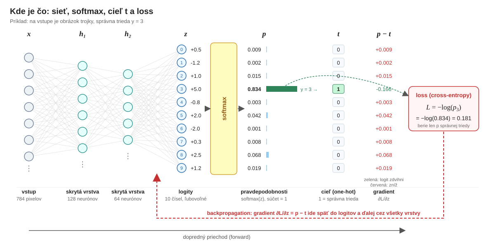
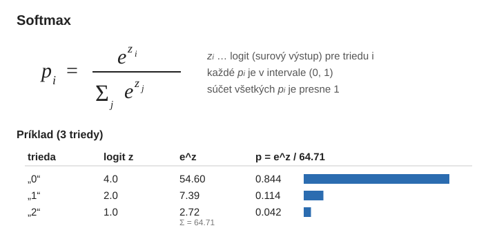
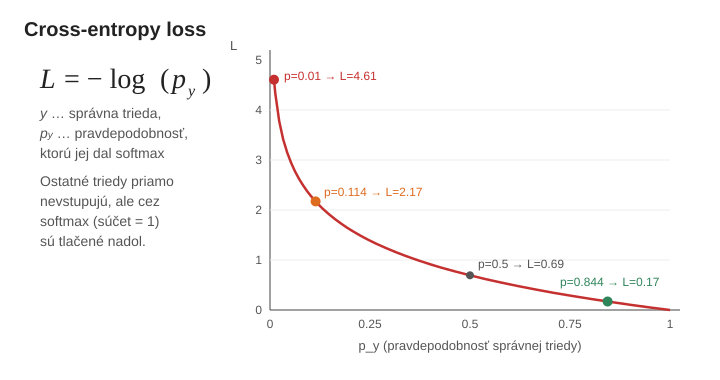
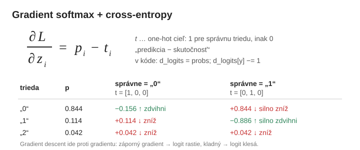

# Softmax a cross-entropy pri tréningu

> **Kód:** [image-recognition/feed_forward.py](image-recognition/feed_forward.py) (`_softmax`, `_forward`, `_loss_and_gradients`)

Posledná vrstva siete má 10 neurónov, jeden pre každú číslicu 0–9. Ich výstupom sú **logity**,
čiže ľubovoľné reálne čísla, napríklad `[-2.1, 0.3, 7.8, …]`. Aby sme ich vedeli čítať ako
„istotu“ modelu a trénovať, potrebujeme dva kroky: **softmax** a **cross-entropy**.

```
obrázok → skryté vrstvy → logity z (10 čísel) → softmax → p (10 pravdepodobností) → loss
```



| Symbol | Čo to je | V kóde |
|---|---|---|
| `x` | vstup: 784 pixelov obrázka 28×28 | `X` |
| `h₁, h₂` | skryté vrstvy (napr. 128 a 64 neurónov) | `activations[1:]` |
| `z` | **logity**: surový výstup poslednej vrstvy, 10 ľubovoľných čísel | `logits` |
| `p` | **pravdepodobnosti** po softmaxe, súčet = 1 | `probs` |
| `y` | **index** správnej triedy (tu `3`) | `y` |
| `t` | **cieľ (one-hot)**: vektor z `y`, `1` na pozícii správnej triedy, inde `0` | v kóde nie je ako pole, robí ho `d_logits[…, y] -= 1` |
| `L` | **loss** (cross-entropy) = `−log(p_y)` | `loss` |
| `p − t` | gradient lossu podľa logitov, odtiaľ začína backpropagation | `d_logits` |

---

## 1. Softmax: z logitov pravdepodobnosti



- Exponenciála z každého logitu urobí kladné číslo a zväčší rozdiely medzi nimi.
- Delenie súčtom zabezpečí, že všetky `p` dajú spolu **1**.
- Triedy teda **súperia**: keď jedna pravdepodobnosť stúpne, ostatné musia klesnúť.

### Prečo práve e^x?

**1. Nezápornosť: z ľubovoľného čísla urobí kladné**

- *Problém:* logity môžu byť akékoľvek reálne čísla, kladné, záporné aj nula.
  Pravdepodobnosť však nikdy nemôže byť záporná.
- *Riešenie:* `e^x` je kladné pre každé reálne `x`, napr. `e⁻⁵ ≈ 0.0067`, `e⁰ = 1`, `e⁵ ≈ 148.4`.
  Po umocnení už nemáme záporné hodnoty a po vydelení súčtom dostaneme platné pravdepodobnosti.

**2. Jednoduchá derivácia: rýchly a stabilný tréning**

- *Matematická vlastnosť:* derivácia `e^x` je opäť `e^x`.
- *Praktický dopad:* backpropagation potrebuje derivácie. Pri kombinácii softmax + cross-entropy
  sa navyše `log` a `e^x` navzájom „vyrušia“, takže gradient podľa logitov je len
  `∂L/∂z_i = p_i − t_i`, teda predpoveď mínus realita (viac v [kapitole 3](#3-gradient-predikcia--skutočnosť)).
  Nepočíta sa nič drahé a nehrozí delenie malými číslami, takže výpočet je rýchly a numericky stabilný.

**3. Zvýraznenie rozdielov: „mäkké“ maximum**

- *Efekt preháňania:* `e^x` rastie veľmi rýchlo, takže malý rozdiel v logitoch sa po umocnení
  výrazne zväčší. V príklade vyššie je logit `4` len 2× väčší ako `2`, ale `e⁴ / e² = e² ≈ 7.4×`.
- *Správanie:* softmax je **mäkká** verzia maxima. Najväčšej hodnote dá vysokú pravdepodobnosť
  (blízko 1) a menšie potlačí k 0, ale **nevynuluje** ich:

  | | „0“ | „1“ | „2“ |
  |---|---|---|---|
  | logity | 4.0 | 2.0 | 1.0 |
  | hardmax (klasické maximum) | 1 | 0 | 0 |
  | softmax | 0.844 | 0.114 | 0.042 |

- *Prečo je to dôležité:* hardmax je skokový a jeho derivácia je takmer všade 0, takže sieť by
  nedostala žiadny signál, ktorým smerom sa zlepšiť. Softmax je hladký a každá trieda má nenulovú
  pravdepodobnosť, preto sa sieť dokáže učiť aj z malých chýb.

V kóde (`feed_forward.py:152`):

```python
logits = logits - logits.max(axis=1, keepdims=True)   # numerická stabilita, výsledok sa nemení
exp_logits = np.exp(logits)
return exp_logits / exp_logits.sum(axis=1, keepdims=True)
```

Odčítanie maxima je len trik proti pretečeniu (`e^1000 = inf`). Softmax je voči posunu
všetkých logitov o rovnakú konštantu invariantný.

---

## 2. Cross-entropy: ako veľmi sa model mýli



Loss sa pozerá **iba na pravdepodobnosť správnej triedy**:

| p správnej triedy | loss −log(p) | význam |
|---|---|---|
| 0.99 | 0.01 | model si je istý a má pravdu, takmer žiadna pokuta |
| 0.844 | 0.17 | dobrý odhad |
| 0.5 | 0.69 | váha medzi možnosťami |
| 0.114 | 2.17 | zlý odhad |
| 0.01 | 4.61 | model si je istý, ale **mýli sa**, veľká pokuta |

Logaritmus trestá sebavedomé chyby oveľa viac než neisté odpovede. Pri `p → 0` ide loss do nekonečna.

V kóde (`feed_forward.py:177`) sa loss spriemeruje cez celý batch. `1e-12` chráni pred `log(0)`:

```python
loss = -np.log(probs[np.arange(n_samples), y] + 1e-12).mean()
```

---

## 3. Gradient: „predikcia − skutočnosť“

Kombinácia softmax + cross-entropy má mimoriadne jednoduchú deriváciu podľa logitov:



- Správna trieda dostane **záporný** gradient, takže jej logit tréning zdvihne.
- Ostatné triedy dostanú **kladný** gradient rovný svojej pravdepodobnosti, takže ich logity klesnú.
- Čím väčšia chyba, tým väčší gradient. Keď je model presný (`p_y ≈ 1`), gradient je ≈ 0 a váhy sa takmer nemenia.

V kóde (`feed_forward.py:179`):

```python
d_logits = probs.copy()
d_logits[np.arange(n_samples), y] -= 1.0   # p − t  (t je one-hot)
d_logits /= n_samples                       # priemer cez batch
```

Odtiaľto ide gradient spätne cez všetky vrstvy (backpropagation) a Adam podľa neho upraví váhy.

---

## 4. Celé to krok po kroku na 10 výstupoch počas tréningu

Cross-entropy sa počíta **iba počas tréningu**. Vtedy pri každom obrázku poznáme správnu
odpoveď `y`. Pri používaní hotového modelu (inferencii) správnu odpoveď nepoznáme, takže
loss ani gradient nepočítame. Stačí softmax a vybrať triedu s najväčším `p`.

Jeden tréningový krok pre jeden obrázok vyzerá takto:

```
1. forward:   obrázok → … → logity z → softmax → p
2. loss:      L = −log(p_y)                      (ako veľmi sa model mýli)
3. gradient:  p − t                              (ktorým smerom posunúť každý z 10 výstupov)
4. backprop:  gradient ide spätne cez vrstvy a Adam upraví váhy
5. ďalší obrázok / batch …
```

### Príklad: obrázok trojky, ktorú model považuje za osmičku

Na vstupe je ručne písaná **3** (`y = 3`). Netrénovaný model si ju zamieňa s **8**:

| výstup (trieda) | 0 | 1 | 2 | **3** | 4 | 5 | 6 | 7 | 8 | 9 |
|---|---|---|---|---|---|---|---|---|---|---|
| logit `z` | 0.5 | −1.0 | 0.2 | **2.0** | −0.5 | 1.0 | −0.8 | 0.3 | 4.0 | 0.1 |
| softmax `p` | 0.023 | 0.005 | 0.017 | **0.103** | 0.008 | 0.038 | 0.006 | 0.019 | 0.764 | 0.015 |
| cieľ `t` | 0 | 0 | 0 | **1** | 0 | 0 | 0 | 0 | 0 | 0 |
| gradient `p − t` | +0.023 | +0.005 | +0.017 | **−0.897** | +0.008 | +0.038 | +0.006 | +0.019 | +0.764 | +0.015 |

**Loss:** z 10 pravdepodobností použijeme iba jednu, tú pri správnej triede 3:

```
L = −log(p_3) = −log(0.103) = 2.27
```

Na ostatných 9 číslach v loss **priamo** nezáleží, lebo `t` je pri nich 0. Nepriamo však
áno: softmax sa sčíta na 1, takže 0.764 pri osmičke je presne to, čo chýba trojke.

**Gradient** hovorí každému z 10 výstupov, čo má urobiť:

- **výstup 3** (správny): `−0.897`, teda silný signál „zdvihni môj logit“,
- **výstup 8** (hlavný omyl): `+0.764`, teda silný signál „znížiť“,
- **ostatné výstupy**: malé kladné hodnoty (0.005 až 0.038), teda slabé „trochu znížiť“.
  Model im aj tak dal málo, preto sa takmer nemenia.

Súčet gradientu cez všetkých 10 výstupov je vždy 0. Čo jedna trieda získa, ostatné stratia.

### Čo sa stane po niekoľkých krokoch tréningu

Pre názornosť posunieme priamo logity o `−gradient` (v skutočnosti sa menia váhy a logity sa
zmenia až cez ne, ďalej sa učí aj na iných obrázkoch, ale smer je rovnaký):

| krok | p(3) | p(8) | loss | predikcia |
|---|---|---|---|---|
| 0 | 0.103 | 0.764 | 2.27 | **8** ✗ |
| 1 | 0.343 | 0.482 | 1.07 | **8** ✗ |
| 2 | 0.586 | 0.263 | 0.53 | **3** ✓ |
| 3 | 0.717 | 0.164 | 0.33 | **3** ✓ |
| 5 | 0.831 | 0.088 | 0.18 | **3** ✓ |

- Loss klesá najrýchlejšie na začiatku, keď je chyba veľká a gradient tiež.
- Keď sa už model trafí (od kroku 2), loss stále klesá. Tréning pokračuje v zvyšovaní istoty,
  nielen v tom, aby bola trojka na prvom mieste.
- Ostatných 8 tried sa takmer nezmenilo. Celý „súboj“ prebehol medzi 3 a 8.

Pre porovnanie: keď model trojku spozná dobre (`p_3 = 0.960`, `p_8 = 0.018`), loss je len
`0.04` a gradient pri trojke `−0.04`. Taký obrázok váhy takmer nezmení a tréning sa sústredí
na obrázky, kde sa model ešte mýli.

### Prečo práve −log: pravdepodobnosť celého datasetu

Fráza „pokuta za sebavedomú chybu“ je len dôsledok. Skutočný dôvod pre `−log` je tento:
chceme, aby model dal **čo najvyššiu pravdepodobnosť správnym odpovediam na všetkých
tréningových obrázkoch naraz**.

Majme batch 3 obrázkov a pravdepodobnosť, ktorú model dal správnej triede:

| obrázok | p_správna | −log(p) |
|---|---|---|
| A | 0.9 | 0.105 |
| B | 0.5 | 0.693 |
| C | 0.01 | 4.605 |

- Pravdepodobnosť, že model „uhádne“ všetky tri, je súčin: `0.9 × 0.5 × 0.01 = 0.0045`.
  Toto chceme **maximalizovať**.
- Súčin tisícov malých čísel pretečie k nule, preto ho **logaritmus** premení na súčet.
- **Mínus** urobí z maximalizácie minimalizáciu: `0.105 + 0.693 + 4.605 = 5.40`.
- `.mean()` v kóde z toho urobí priemer: `5.40 / 3 = 1.80`.

Obrázok C zmenšil celý súčin 100-krát (×0.01), preto tvorí väčšinu lossu. Model mu dal len
1 %, takže zvyšných 99 % dal iným triedam, teda si bol istý niečím nesprávnym. To je tá
„pokuta za sebavedomú chybu“.

---

## 5. Kedysi tanh a ±1, dnes softmax

V 80. a 90. rokoch mala výstupná vrstva často aktiváciu `tanh` (rozsah −1 až 1) a loss bol
**MSE** (stredná kvadratická chyba). Cieľ pre našu trojku by vyzeral takto:

```
softmax + cross-entropy:  t = [ 0,  0,  0, 1,  0,  0,  0,  0,  0,  0]
tanh + MSE (kedysi):      t = [-1, -1, -1, 1, -1, -1, -1, -1, -1, -1]
```

Neplatí to pre **vstupy**. Tie sa normalizujú stále (pixely na `[0, 1]`, `[-1, 1]` alebo na
priemer 0). Zmenilo sa len kódovanie **výstupov** a loss.

### Prečo sa od toho upustilo

**1. Pri sebavedomej chybe sa tréning zasekne.** Pri tanh + MSE je gradient pre výstup 3
`2·(a − 1)·(1 − a²)`. Člen `(1 − a²)` je derivácia tanh a pri saturácii (`a ≈ ±1`) je
takmer 0. Porovnanie pre výstup 3 v našom príklade, keď model trojku silno popiera:

| logit z₃ | tanh + MSE: výstup a | MSE gradient pre z₃ | softmax + CE: p₃ | CE gradient pre z₃ |
|---|---|---|---|---|
| −3.0 (istý, že to nie je 3) | −0.995 | **−0.04** | 0.0008 | **−0.999** |
| −1.0 | −0.762 | −1.48 | 0.006 | −0.994 |
| 0.0 | 0.000 | −2.00 | 0.015 | −0.985 |

Pri MSE dostane najhoršia chyba (`z₃ = −3`) **najmenší** gradient, takže sieť sa z nej takmer
neučí. Pri cross-entropy sa derivácia softmaxu s logaritmom vykráti, zostane `p − t` a veľká
chyba dá veľký gradient (≈ −1).

**2. Výstupy tanh nie sú pravdepodobnosti.** 10 hodnôt z tanh sa nesčíta na 1 a triedy
medzi sebou nesúperia. Model môže povedať „+0.9 pre 3 aj +0.9 pre 8“. Softmax vynúti
rozdelenie, z ktorého sa dá čítať, ako veľmi model váha medzi 3 a 8.

**3. Ohraničená vs. neohraničená chyba.** MSE pri jednom výstupe narastie najviac na
`(1 − (−1))² = 4`. Cross-entropy ide pri `p → 0` do nekonečna (pri `p₃ = 0.0008` je to 7.2),
takže úplne zlé odpovede majú v loss väčšiu váhu.

Kde sa to stále používa: `tanh` v niektorých skrytých vrstvách (napr. LSTM), MSE pri
**regresii** (predikcia čísla, nie triedy) a pri dvoch triedach sigmoid + binary
cross-entropy, čo je ten istý princíp ako softmax + CE.

---

## Zhrnutie

1. **Softmax** premení 10 logitov na 10 pravdepodobností, ktoré dajú spolu 1.
2. **Cross-entropy** `−log(p_správna)` meria, koľko pravdepodobnosti model dal správnej odpovedi.
3. **Gradient** na výstupe je `p − t`. Tréning tlačí správnu triedu nahor a ostatné nadol.
4. Loss a gradient sa počítajú **iba pri tréningu**, keď poznáme správnu odpoveď. Pri inferencii
   stačí softmax.
5. Kedysi sa používal **tanh + MSE s cieľmi ±1**. Softmax + cross-entropy ho nahradili, lebo
   sebavedomé chyby dávajú veľký gradient namiesto takmer nulového.

> **Pozor:** softmax vždy niečo „rozdelí“. Aj na obrázok, ktorý vôbec nie je číslica, model
> vráti napr. 0.97 pre nejakú triedu. Je to istota modelu, nie kalibrovaná pravdepodobnosť
> (pozri ukážku 5a vs. 5b v [rozpoznavanie-obrazkov.md](rozpoznavanie-obrazkov.md)).
